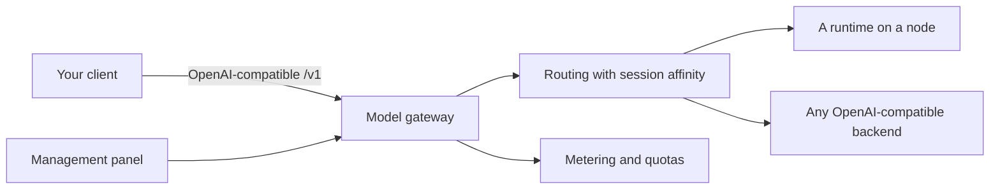

# Arona — بوابة النماذج ولوحة النشر

Arona هي حيث تصبح النماذج شيئًا تستطيع المنصة استخدامه: بوابة متوافقة مع OpenAI
أمام عتادك أنت، مع لوحة التحكم التي تديرها. وتجيب عن سؤال واحد — كيف ينتقل
النموذج من «نُزِّل إلى مكان ما» إلى «متاح للجميع على المنصة، ومقاس، وقابل
للتوجيه».

## ما تفعله

- **البوابة** — تخدم نقاط نهاية `/v1/*` المتوافقة مع OpenAI، فيستطيع أي عميل
  متوافق مع OpenAI أن يتحدث إلى نماذج تستضيفها أنت بنفسك.
- **النشر** — تنزّل أوزان النماذج إلى عقد GPU، وتشغّل بيئة التشغيل هناك، وتسجّل
  الناتج خلفيةً قابلة للتوجيه. وإيقاف النشر يلغي تسجيلها مرة أخرى.
- **التوجيه** — تُسجَّل الخلفيات كبيئة تشغيل محلية أو كأي خدمة متوافقة مع
  OpenAI، وتُفحص صحتها، ويُوجَّه إليها بترابط الجلسة. والخلفية التي لم تنجح في
  فحص صحتها الأول تُرفَض بدلًا من تجربتها.
- **الهوية والقياس** — تصادق مفاتيح API نقاط `/v1/*`؛ ويُسجَّل كل استدعاء لكل
  مفتاح بالرموز والنموذج والخلفية والتكلفة، وتطبّق المستويات الحصص.

## كيف تستخدمها

يلتقي معظم الناس بـ Arona عبر اللوحة: أنشئ مفتاح API، ووجّه نموذجًا إلى عقدة،
وراقب الصحة والاستخدام. أما المحادثة نفسها فمكانها آخر — تتحدث منصة العمل مع
Arona عبر سطح RPC الخاص به، ولا يُشحن Arona بأي واجهة محادثة خاصة به.

السطح الدقيق لـ API، ووصفات النشر، ومرجع التهيئة من نصيب المنتج؛ وهذا المركز لا
يكرّرها.

> تطوير مبكّر. ليس جاهزًا للاستخدام العام بعد.

## لمزيد من التفاصيل

- [Shittim Chest](./chest.md) — السطح الذي يستهلك Arona.
- [Entelecheia](./entelecheia.md) — منصة الوكلاء الواقعة خلف المحادثة.
- [البدء السريع](../getting-started/quickstart.md) — انشر نموذجك الأول.
