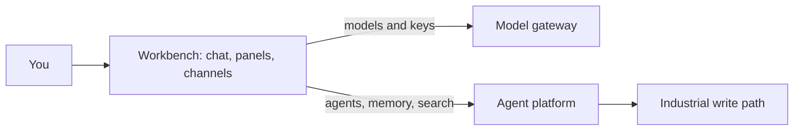

# Shittim Chest — المحادثة واللوحات والتكاملات

Shittim Chest هو السطح: المحادثة واللوحات والتكاملات متعددة القنوات — المكان
الذي تصبح فيه قدرة النموذج شيئًا تستخدمه كل يوم. يأخذ النماذج والذاكرة من
Arona، والوكلاء واللوحات وتدفقات العمل الصناعية من entelecheia.

## ما تفعله

- **المحادثة** — تُحفظ المحادثات على الخادم باستجابات متدفقة، فتبقى السجلات
  وخطوات التفكير واستدعاءات الأدوات بعد إعادة تحميل الصفحة وبعد إعادة تشغيل
  الخادم.
- **اللوحات** — تُنشأ اللوحة من موجّه واحد: يولّد المحرك التخطيط والمكوّنات
  ويحفظها في مساحة العمل. ويبقى التحرير بنيويًا — ارتباطات مصادر البيانات،
  وقوائم المكوّنات، وحالة الاتصال مرئية — لا صندوقًا أسود. وتوجد ثلاثة أنواع:
  جداول البيانات، وخطوط أنابيب الوسائط، والتوائم ثلاثية الأبعاد لأسطول الأجهزة.
- **القنوات** — يمكن أن تصل المحادثة نفسها من منصة مراسلة فورية ويُجاب عنها
  هناك، عبر جسر قنوات.
- **البحث والمعرفة** — يشمل البحث الدلالي مساحة العمل والذاكرة طويلة الأمد في
  قائمة مرتّبة واحدة، ويمكن استرجاع قواعد المعرفة من السطح نفسه.
- **المصادقة** — مفوَّضة: تحدد البوابة من هو المستدعي، وتقيّد الأدوار عمليات
  الكتابة على اللوحات ومساحات العمل.

## كيف تستخدمها

كتطبيق سطح مكتب أو في المتصفح، بمفتاح API من Arona. واجهة الويب أسرع طريق
للدخول؛ ويضيف تطبيق سطح المكتب الصدفة الأصلية.

ومرجع اللوحات، وتهيئة القنوات، ومتغيرات البيئة من نصيب المنتج؛ وهذا المركز لا
يكرّرها.

## لمزيد من التفاصيل

- [Arona](./arona.md) — من أين تأتي النماذج والمفاتيح والاستخدام.
- [Entelecheia](./entelecheia.md) — من أين تأتي الوكلاء واللوحات والذاكرة.
- [دليل واجهة الويب](../webui/guide.md) — الرواية نفسها، شاشة بشاشة.
