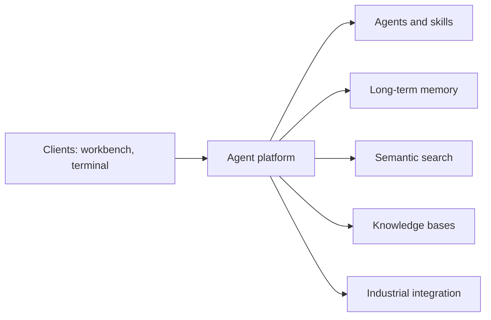

# Entelecheia — منصة الوكلاء والذاكرة

Entelecheia هي منصة الوكلاء: تشغّل الوكلاء، وتحتفظ بذاكرتهم طويلة الأمد، وتجيب
البحث الدلالي، وتحمل طبقة التكامل الصناعي. وكل من Arona وShittim Chest مستهلكان
لها — فالقدرة على إجراء محادثة بذاكرة، أو على قيادة لوحة بوكيل، تأتي من هنا.

## ما تفعله

- **الوكلاء** — وكلاء متخصصون، لكل منهم هويته وأدواته ومهاراته. وسلسلة المهارات
  تركّب استدعاءات النماذج وتنفيذات الأدوات في خط أنابيب؛ وقبل أن يجري أي استدعاء
  تُسترجع الذكريات والمعارف ذات الصلة وتُحقن في السياق.
- **الذاكرة طويلة الأمد** — تُخزَّن الحلقات والكيانات والمنتجات كعُقد في مخطط
  ذاكرة وتُنسخ في فهرس متجهي. ويجمع الاستدعاء بين التشابه واجتياز المخطط والتحلّل
  الزمني، ويدمج تمرير دوري العقد المترابطة. وتبقى الذاكرة بعد إعادة التشغيل.
- **البحث الدلالي** — قائمة مرتّبة واحدة فوق مصدرين: فهرس مساحة العمل (المستندات
  وتقارير الوكلاء وقواعد المعرفة) والذاكرة طويلة الأمد.
- **قواعد المعرفة** — أنشئ مجموعة، وأضف مستندات، واشترك الوكلاء فيها؛ ويسترجع
  منها سطح البحث نفسه.
- **التأمل** — تُخزَّن الدروس المستفادة وتُعاد حقنها في الموجّهات اللاحقة، وهو شكل
  ثانٍ أخف من الذاكرة الدائمة يسير إلى جانب المخطط.
- **التكامل الصناعي** — يمرّ مسار الكتابة إلى المعدات الحقيقية عبر هذه الطبقة،
  حيث تقع فحوص السياسات والموافقات.

## كيف تستخدمها

يتصل العملاء عبر سطح JSON-RPC الخاص بالمنصة برمز اتصال؛ وواجهة الطرفية ومنصة
العمل للمحادثة كلتاهما من هذا القبيل. وتشغيل entelecheia بنفسك اختياري — فمعظم
عمليات النشر مُستضافة لك.

وكتالوج الوكلاء، وتأليف المهارات، والمرجع التشغيلي من نصيب المنتج؛ وهذا المركز
لا يكرّرها.

## لمزيد من التفاصيل

- [مبادئ السلامة](../philosophy/safety.md) — لماذا لا يلمس النموذج العالم أبدًا.
- [Evernight](./evernight.md) — الطبقة الأسفل، حيث تتحرك المعدات فعليًا.
- [Shittim Chest](./chest.md) — السطح الذي يلتقي به معظم الناس الوكلاء.
