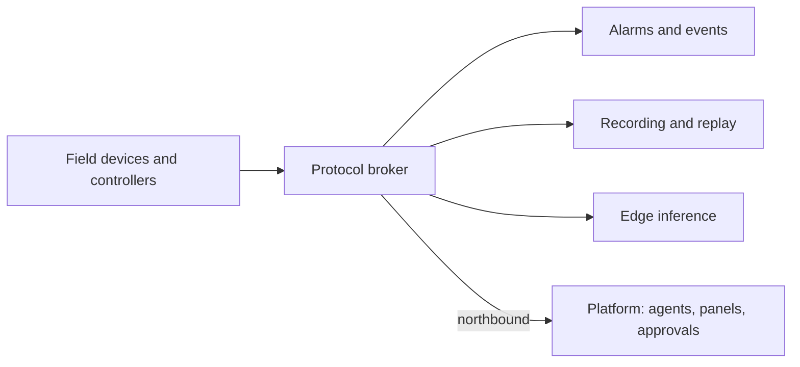

# Evernight — وسيط البروتوكولات الصناعية

Evernight هو الطرفية الصناعية: وسيط عابر للمنصات يتحدث البروتوكولات الموجودة في
موقع حقيقي — Modbus، وS7comm، وMC Protocol، وEtherNet/IP، وEtherCAT، وCAN،
وOPC UA، وMQTT — ويستطلع الحساسات، ويقيّم الإنذارات، ويدفع الأحداث صعودًا إلى
المنصة. ويدير أيضاً بيئات تشغيل النماذج على العقدة نفسها للاستدلال الذي يبقى
محليًا.

## ما يفعله

- **بروتوكولات الميدان** — تحوّل المحوّلات قراءة كل بروتوكول وكتابته إلى قراءات
  وأوامر مُنمَّطة. والكتابات محكومة ببوابة: تحتاج الكتابة الصناعية إلى التحقق من
  السياسات وموافقة بشرية في المنبع قبل أن يتحرك أي شيء.
- **الاستشعار والإنذارات** — تستطلع كل محطة بدورتها القابلة للتهيئة؛ وتظهر
  الأعطال أحداث صحة لا صمتًا. وتقيّم قواعد الإنذار القراءات وتصدر أحداثًا موجَّهة.
- **الوقت والتسجيل** — تحمل القراءات طابعًا زمنيًا جِداريًا وآخر رتيبًا، فلا
  تتناقض أبدًا طريقة العرض مع الترتيب. ويحفظ خط التقاط التسجيلات مخزنًا حلقيًا
  ويكتب المقاطع على القرص، ويستطيع إعادة تشغيلها في مسار المشغِّلات — وهو شرط
  مسبق لحالة العالم وللتعلّم معًا.
- **خدمة النماذج على الطرفية** — تُنشَر بيئات تشغيل النماذج وتُشرَف على العقدة
  نفسها، مع تفضيل GPU والارتداد إلى CPU. وهذا هو ما يجعل الاستدلال التفاعلي
  مستقلًا عن وجود نموذج متصل.
- **الاتجاه الشمالي** — تتدفق الأحداث صعودًا إلى المنصة عبر مقبس محلي؛ وتسجّل
  بوابات الأجهزة والسحابة هوية العقدة والقياسات عن بُعد. وكل إدخال/إخراج مادي
  يمر عبر evernight.

## كيف تستخدمه

على الآلة التي تلمس المعدات. وكل ما فوقه — الوكلاء واللوحات والموافقات — يتحدث
إليه عبر المنصة، لا إلى ناقل الميدان مباشرة.

وتهيئة البروتوكولات، وتوزيعة الجهاز، ومرجع السائقين من نصيب المنتج؛ وهذا المركز
لا يكرّرها.

## لمزيد من التفاصيل

- [مبادئ السلامة](../philosophy/safety.md) — لماذا تُحكم الكتابات ببوابة.
- [Entelecheia](./entelecheia.md) — الطبقة الأعلى، حيث تقع الموافقات.
- [الحلقة المغلقة](../philosophy/closed-loop.md) — أين تندرج هذه الشريحة.
