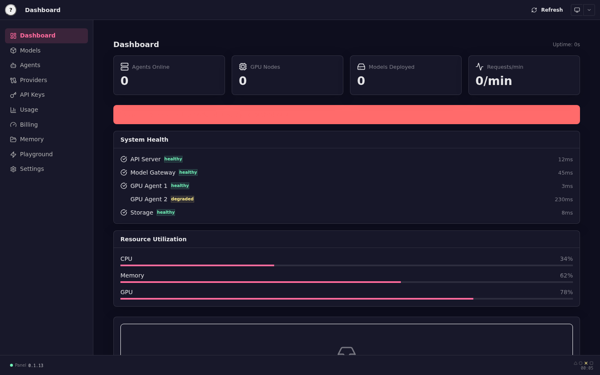

# واجهة الويب — الرحلة من جملتك الأولى

حساب واحد، ومفتاح واحد، ومحادثة واحدة. تسير هذه الصفحة المسار نفسه الذي يسلكه
المنتج — يصبح النموذج متاحًا، ثم يصادقه مفتاح، ثم يجري دور مع الذاكرة، ثم
تحوّله لوحة إلى شيء تستطيع تشغيله.

## النماذج: من المصدر إلى الاستدعاء

ينتقل النموذج من «موجود» إلى «جاهز للمحادثة» في أربع مراحل: **المصدر** (كتالوج
المزوّدين — بيانات وصفية لا استدلال) ← **التسجيل** (خلفية، إما بيئة تشغيل
محلية أو أي خدمة متوافقة مع OpenAI؛ وتبقى محفوظة عبر إعادة التشغيل) ←
**النشر** (يُسلَّم معرّف النموذج إلى عقدة، فتنزّله وتشغّل بيئة التشغيل) ←
**التوجيه** (موازنة حمل «الأقل قيد التنفيذ» مع ترابط الجلسة). والخلفية التي لم
تنجح في فحص صحتها الأول تُرفَض بدلًا من تجربتها.

## الهوية والقياس

**مفاتيح API** هي هويتك — تصادق البوابة برمز Bearer، وكل من `curl` ومنصة العمل
يقدّم واحدًا عند الباب. **الاستخدام** دفتر قيد لكل استدعاء ولكل مفتاح: الرموز،
والنموذج، والخلفية، والتكلفة. وتحدّد مستويات **الفوترة** الحصص؛ وبلوغ أحدها رفض
قاطع لا إبطاء.

## المحادثة والذاكرة

يمرّ كل دور عبر خدمة الذاكرة — وتخبرك الشارة على كل دور بحدوث ذلك من عدمه.
`Memory on` تعني أنه أُدخلت ذكريات طويلة الأمد ذات صلة قبل التوجيه؛
و`Memory offline` تعني أنه يتعذر الوصول إلى خدمة الذاكرة (إشارة صدق لا خلل
برمجي)؛ و`disabled` تعني أنه لم يُعثر على شيء ذي صلة. وتُستخرج الأدوار المكتملة
وتُحفظ، فتبقى الذاكرة قائمة بعد إعادة التشغيل — ويمكن حذف مدخلات الكتابة
الراجعة مباشرةً من صفحة الذاكرة.

## اللوحات والتحكم الصناعي

موجّه واحد ينشئ لوحة؛ يولّد المحرك التخطيط ويحفظه في مساحة العمل. والتحرير
بنيوي — ارتباطات مصادر البيانات، وقوائم المكوّنات، وحالات الاتصال — وليس
صندوقًا أسود. الطوبولوجيا والهولوغرام منظوران للأسطول نفسه؛ ويضيف قسم التقارير
بحثًا دلاليًا في السجل. وتمرّ عمليات الكتابة الصناعية بالتحقق من السياسات
و**الموافقة البشرية** قبل أن يتحرك أي شيء: نهاية الحلقة المغلقة، وأثقل خطواتها.

## لمزيد من التفاصيل

- [Arona](../platforms/arona.md) — البوابة ولوحة النشر.
- [Shittim Chest](../platforms/chest.md) — منصة العمل ولوحاتها.
- [Entelecheia](../platforms/entelecheia.md) — الوكلاء ومساحات العمل وبوابة الكتابة الصناعية.
