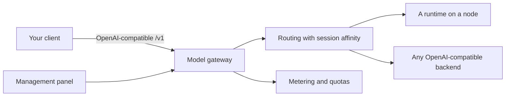

# Arona — Modell-Gateway und Bereitstellungs-Panel

Arona ist der Ort, an dem Modelle zu etwas werden, das die Plattform nutzen
kann: ein OpenAI-kompatibles Gateway vor Ihrer eigenen Hardware, plus die
Konsole, die es verwaltet. Damit ist eine Frage beantwortet — wie wird aus
einem Modell, das „irgendwo heruntergeladen" ist, eines, das „für alle auf der
Plattform verfügbar, gemessen und routbar" ist.

## Was es tut

- **Gateway** — bedient die OpenAI-kompatiblen `/v1/*`-Endpunkte, sodass jeder
  OpenAI-kompatible Client mit Modellen sprechen kann, die Sie selbst hosten.
- **Bereitstellung** — lädt Modellgewichte auf GPU-Knoten herunter, startet dort
  die Runtime und registriert das Ergebnis als routbares Backend. Wird die
  Bereitstellung gestoppt, wird das Backend wieder abgemeldet.
- **Routing** — Backends werden als lokale Runtime oder als beliebiger
  OpenAI-kompatibler Dienst registriert, per Health-Probe geprüft und mit
  Sitzungsaffinität geroutet. Ein Backend, das seine erste Health-Probe nicht
  bestanden hat, wird verweigert statt versucht.
- **Identität und Messung** — API keys authentifizieren `/v1/*`; jeder Aufruf
  wird pro Key mit Tokens, Modell, Backend und Kosten aufgezeichnet, und Stufen
  setzen Kontingente durch.

## So nutzen Sie es

Die meisten begegnen Arona über das Panel: API key erstellen, ein Modell auf
einen Knoten richten, Health und Nutzung beobachten. Der Chat selbst lebt
anderswo — die Werkbank spricht über Aronas RPC-Oberfläche mit Arona, und Arona
bringt keine eigene Chat-UI mit.

Die exakte API-Oberfläche, Bereitstellungsrezepte und die
Konfigurationsreferenz gehören zum Produkt; dieser Hub dupliziert sie nicht.

> Frühe Entwicklung. Noch nicht für die öffentliche Nutzung bereit.

## Weiterführendes

- [Shittim Chest](./chest.md) — die Oberfläche, die Arona konsumiert.
- [Entelecheia](./entelecheia.md) — die Agenten-Plattform hinter dem Chat.
- [Schnellstart](../getting-started/quickstart.md) — Ihr erstes Modell bereitstellen.
