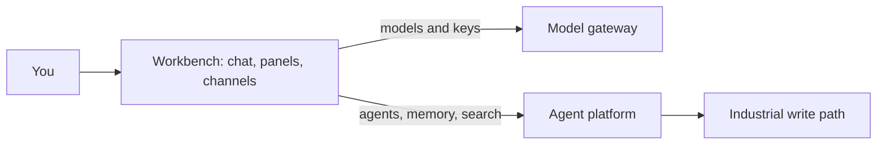

# Shittim Chest — Chat, Panels und Integrationen

Shittim Chest ist die Oberfläche: Chat, Panels und Multi-Kanal-Integrationen —
der Ort, an dem die Fähigkeiten des Modells zu etwas werden, das Sie täglich
nutzen. Es bezieht Modelle und Speicher von Arona sowie Agenten, Panels und
industrielle Workflows von entelecheia.

## Was es tut

- **Chat** — Gespräche werden serverseitig mit Streaming-Antworten persistiert,
  sodass Historie, Denkschritte und Tool-Aufrufe ein Neuladen und einen
  Neustart überstehen.
- **Panels** — ein Panel entsteht aus einem einzigen Prompt: Die Engine
  erzeugt Layout und Komponenten und persistiert sie im Workspace. Die
  Bearbeitung bleibt strukturell — Datenquellen-Bindungen, Komponentenlisten
  und Verbindungszustand sind sichtbar — statt eine Black Box zu sein. Es gibt
  drei Arten: Datentabellen, Medien-Pipelines und 3D-Zwillinge einer
  Geräteflotte.
- **Kanäle** — dieselbe Unterhaltung kann von einer Instant-Messaging-Plattform
  kommen und dort über eine Kanal-Bridge beantwortet werden.
- **Suche und Wissen** — semantische Suche erstreckt sich über den Workspace
  und den Langzeitspeicher in einer gerankten Liste, und Wissensbasen sind über
  dieselbe Oberfläche abrufbar.
- **Auth** — delegiert: Das Gateway stellt fest, wer der Aufrufer ist, und
  Rollen regeln Schreibzugriffe auf Panels und Workspaces.

## So nutzen Sie es

Als Desktop-Anwendung oder im Browser, mit einem API key von Arona. Die WebUI
ist der schnellste Weg hinein; die Desktop-App ergänzt die native Shell.

Die Panel-Referenz, die Kanalkonfiguration und die Umgebungsvariablen gehören
zum Produkt; dieser Hub dupliziert sie nicht.

## Weiterführendes

- [Arona](./arona.md) — woher Modelle, Keys und Nutzung kommen.
- [Entelecheia](./entelecheia.md) — woher Agenten, Panels und Speicher kommen.
- [Web-UI-Anleitung](../webui/guide.md) — dieselbe Geschichte, Bildschirm für Bildschirm.
