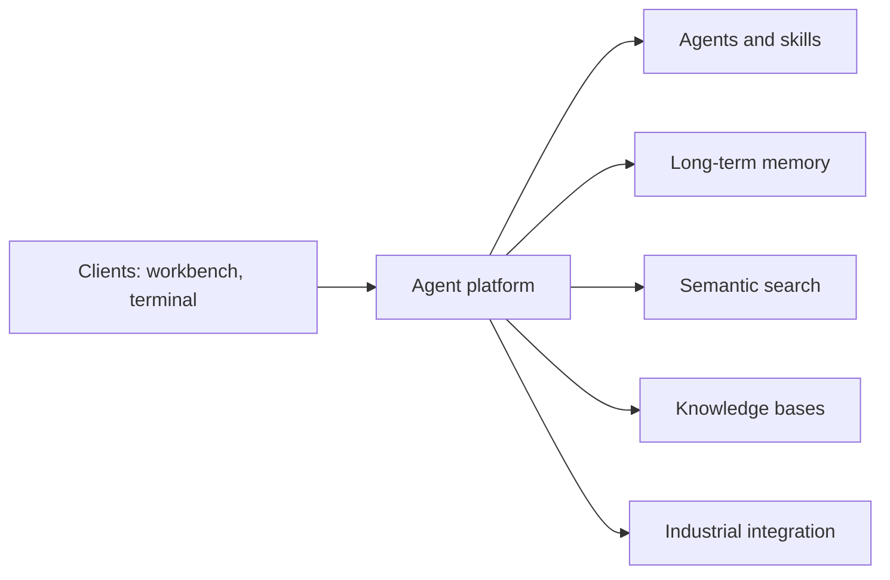

# Entelecheia — Agenten-Plattform und Speicher

Entelecheia ist die Agenten-Plattform: Sie führt die Agenten aus, pflegt deren
Langzeitspeicher, beantwortet semantische Suche und trägt die industrielle
Integrationsschicht. Arona und Shittim Chest sind beide Konsumenten davon —
die Fähigkeit, eine Unterhaltung mit Speicher zu führen oder ein Panel mit
einem Agenten zu steuern, kommt von hier.

## Was es tut

- **Agenten** — spezialisierte Agenten, jeder mit eigener Identität, eigenen
  Tools und Skills. Eine Skill-Kette fügt Modellaufrufe und Tool-Ausführungen
  zu einer Pipeline zusammen; bevor ein Aufruf läuft, werden die relevanten
  Erinnerungen und Wissensinhalte abgerufen und in den Kontext injiziert.
- **Langzeitspeicher** — Episoden, Entitäten und Artefakte werden als Knoten in
  einem Speichergraphen abgelegt und in einen Vektorindex gespiegelt. Recall
  kombiniert Ähnlichkeit, Graph-Traversierung und Zeitverfall, und ein
  periodischer Durchlauf konsolidiert verwandte Knoten. Der Speicher übersteht
  Neustarts.
- **Semantische Suche** — eine gerankte Liste über zwei Quellen: den
  Workspace-Index (Dokumente, Agentenberichte, Wissensbasen) und den
  Langzeitspeicher.
- **Wissensbasen** — eine Sammlung anlegen, Dokumente hinzufügen, Agenten
  darauf abonnieren; dieselbe Suchoberfläche ruft daraus ab.
- **Reflexion** — gelernte Lektionen werden gespeichert und in spätere Prompts
  reinjiziert, eine zweite, leichtere Form persistenten Gedächtnisses neben dem
  Graphen.
- **Industrielle Integration** — der Schreibpfad zu echter Hardware führt durch
  diese Schicht, in der Richtlinienprüfungen und Freigaben sitzen.

## So nutzen Sie es

Clients verbinden sich mit einem Verbindungstoken über die JSON-RPC-Oberfläche
der Plattform; die Terminal-Oberfläche und die Chat-Werkbank sind beide solche
Clients. Entelecheia selbst zu betreiben ist optional — die meisten
Bereitstellungen werden für Sie gehostet.

Der Agentenkatalog, das Verfassen von Skills und die Betriebsreferenz gehören
zum Produkt; dieser Hub dupliziert sie nicht.

## Weiterführendes

- [Sicherheitsprinzipien](../philosophy/safety.md) — warum das Modell die Welt nie berührt.
- [Evernight](./evernight.md) — die Schicht darunter, in der sich Anlagen tatsächlich bewegen.
- [Shittim Chest](./chest.md) — die Oberfläche, über die die meisten Agenten begegnen.
