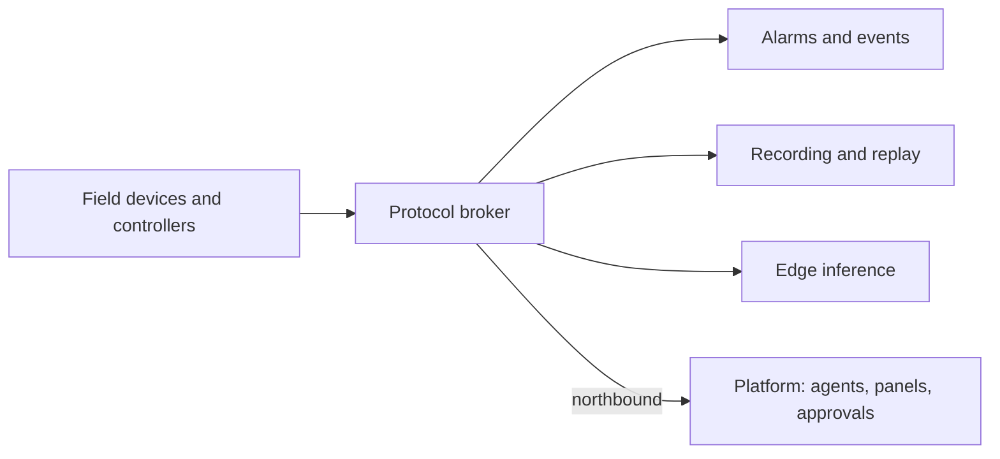

# Evernight — Industrieller Protokoll-Broker

Evernight ist die industrielle Edge: ein plattformübergreifender Broker, der
die Protokolle spricht, die an einem realen Standort vorkommen — Modbus,
S7comm, MC Protocol, EtherNet/IP, EtherCAT, CAN, OPC UA, MQTT —, Sensoren
abfragt, Alarme auswertet und Ereignisse nach oben in die Plattform pusht. Er
verwaltet außerdem Modell-Runtimes auf demselben Knoten für Inferenz, die
lokal bleibt.

## Was es tut

- **Feldprotokolle** — Adapter wandeln das Lesen und Schreiben jedes Protokolls
  in typisierte Messwerte und Kommandos um. Schreibvorgänge sind gesperrt: Eine
  industrielle Schreiboperation braucht vorab Richtlinienprüfung und
  menschliche Freigabe upstream, bevor sich etwas bewegt.
- **Erfassung und Alarme** — jede Station pollt in ihrem eigenen
  konfigurierbaren Zyklus; Fehler erscheinen als Health-Ereignisse statt als
  Stille. Alarmregeln werten Messwerte aus und emittieren geroutete Ereignisse.
- **Zeit und Aufzeichnung** — Messwerte tragen sowohl einen Wanduhr- als auch
  einen monotonen Zeitstempel, sodass Anzeige und Reihenfolge nie
  auseinanderlaufen. Die Aufzeichnungspipeline hält einen Ringpuffer und
  schreibt Segmente auf die Platte; sie kann sie zurück in den Trigger-Pfad
  wiedergeben — die Voraussetzung für Weltzustand und Lernen gleichermaßen.
- **Edge-Modell-Serving** — Modell-Runtimes werden auf dem Knoten selbst
  bereitgestellt und überwacht, GPU bevorzugt mit CPU-Fallback. Das macht
  reaktive Inferenz unabhängig von einem online verfügbaren Modell.
- **Northbound** — Ereignisse fließen über einen lokalen Socket nach oben in
  die Plattform; Geräte- und Cloud-Gateways registrieren Knotenidentität und
  Telemetrie. Jede physische I/O läuft über evernight.

## So nutzen Sie es

Auf der Maschine, die die Anlagen berührt. Alles darüber — Agenten, Panels,
Freigaben — spricht über die Plattform mit evernight, nie direkt mit dem
Feldbus.

Die Protokollkonfiguration, die Appliance-Distribution und die
Treibervertrag gehören zum Produkt; dieser Hub dupliziert sie nicht.

## Weiterführendes

- [Sicherheitsprinzipien](../philosophy/safety.md) — warum Schreibvorgänge gesperrt sind.
- [Entelecheia](./entelecheia.md) — die Schicht darüber, in der Freigaben sitzen.
- [Der Geschlossene Regelkreis](../philosophy/closed-loop.md) — wo dieses Segment hineinpasst.
