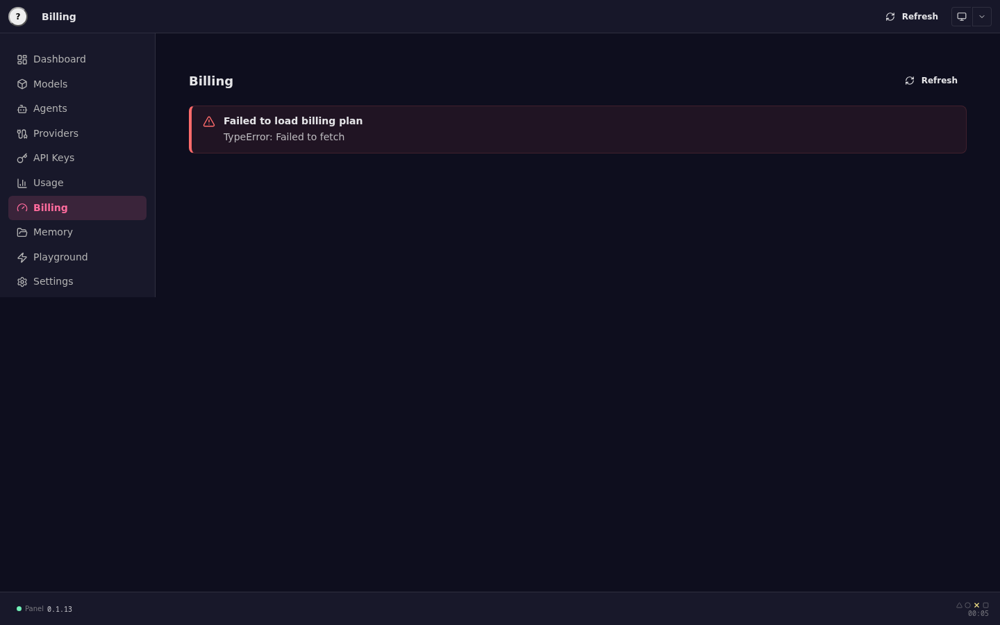

# Web UI — die Reise ab Ihrem ersten Satz

Ein Konto, ein Key, eine Unterhaltung. Diese Seite durchläuft denselben Pfad
wie das Produkt — ein Modell wird verfügbar, ein Key authentifiziert es, eine
Runde läuft mit Speicher, und ein Panel macht daraus etwas, das Sie bedienen
können.

## Modelle: von der Quelle bis zum Aufruf

Ein Modell durchläuft vier Stufen von „vorhanden“ bis „chatbereit“: **Quelle**
(der Provider-Katalog — Metadaten, keine Inferenz) → **Registrierung** (ein
Backend, entweder eine lokale Runtime oder ein beliebiger
OpenAI-kompatibler Dienst; es übersteht Neustarts) → **Bereitstellung** (eine
Modell-ID wird an einen Knoten übergeben, der sie herunterlädt und die Runtime
startet) → **Routing** (Lastverteilung nach den wenigsten laufenden Anfragen
mit Sitzungsaffinität). Ein Backend, das seine erste Health-Probe nicht
bestanden hat, wird verweigert statt versucht.

## Identität und Verbrauchsmessung

**API keys** sind Ihre Identität — das Gateway authentifiziert mit einem
Bearer-Token, und sowohl `curl` als auch die Werkbank zeigen an der Tür einen
vor. **Nutzung** ist ein Ledger pro Aufruf und Key: Tokens, Modell, Backend,
Kosten. **Abrechnungs**-Stufen setzen Kontingente; wer eines erreicht, erhält
eine harte Ablehnung, keine Verlangsamung.

## Chat und Memory

Jede Runde läuft durch den Memory-Dienst — das Badge an jeder Runde verrät
Ihnen, ob das geschah. `Memory on` bedeutet, dass relevante
Langzeiterinnerungen vor dem Routing injiziert wurden; `Memory offline`
bedeutet, dass der Memory-Dienst nicht erreichbar ist (ein Ehrlichkeitssignal,
kein Bug); `disabled` bedeutet, dass nichts Relevantes gefunden wurde.
Abgeschlossene Runden werden extrahiert und persistiert, sodass Memory
Neustarts überlebt — und Write-Back-Einträge lassen sich direkt auf der
Memory-Seite löschen.

## Panels und industrielle Steuerung

Ein Prompt erzeugt ein Panel; die Engine generiert das Layout und persistiert
es im Workspace. Die Bearbeitung ist strukturell — Datenquellen-Bindungen,
Komponentenlisten, Verbindungszustände — keine Black Box. Topology und
Holographic sind zwei Ansichten derselben Flotte; Reports ergänzt eine
semantische Suche über die Historie. Industrielle Schreibvorgänge durchlaufen
Richtlinienvalidierung und **menschliche Freigabe**, bevor sich etwas bewegt:
das Ende des geschlossenen Regelkreises — und zugleich dessen schwerster
Schritt.

## Weiterführendes

- [Arona](../platforms/arona.md) — das Gateway und das Bereitstellungs-Panel.
- [Shittim Chest](../platforms/chest.md) — die Werkbank und ihre Panels.
- [Entelecheia](../platforms/entelecheia.md) — Agenten, Workspaces und das industrielle Schreib-Gate.
