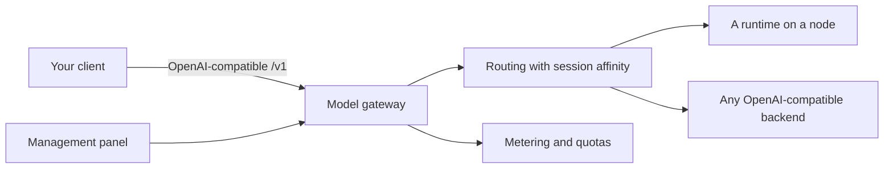

# Arona — Model Gateway and Deployment Panel

Arona is where models become something the platform can use: an
OpenAI-compatible gateway in front of your own hardware, plus the console that
manages it. It answers one question — how does a model go from "downloaded
somewhere" to "available to everyone on the platform, metered, and routable".

## What it does

- **Gateway** — serves the OpenAI-compatible `/v1/*` endpoints, so any
  OpenAI-compatible client can talk to models you host yourself.
- **Deployment** — downloads model weights onto GPU nodes, starts the runtime
  there, and registers the result as a routable backend. Stopping the
  deployment unregisters it again.
- **Routing** — backends are registered as a local runtime or as any
  OpenAI-compatible service, health-probed, and routed to with session
  affinity. A backend that has not passed its first health probe is refused
  rather than tried.
- **Identity and metering** — API keys authenticate `/v1/*`; every call is
  recorded per key with tokens, model, backend and cost, and tiers enforce
  quotas.

## How you use it

Most people meet Arona through the panel: create an API key, point a model at a
node, watch health and usage. Chat itself lives elsewhere — the workbench talks
to Arona over its RPC surface, and Arona ships no chat UI of its own.

The exact API surface, deployment recipes and configuration reference belong
to the product; this hub does not duplicate them.

> Early development. Not yet ready for public use.

## Where to go deeper

- [Shittim Chest](./chest.md) — the surface that consumes Arona.
- [Entelecheia](./entelecheia.md) — the agent platform behind chat.
- [Quickstart](../getting-started/quickstart.md) — deploy your first model.
