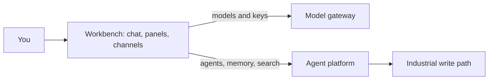

# Shittim Chest — Chat, Panels and Integrations

Shittim Chest is the surface: chat, panels and multi-channel integrations — the
place where the model's capability becomes something you use every day. It
takes models and memory from Arona, and agents, panels and industrial workflows
from entelecheia.

## What it does

- **Chat** — conversations are persisted server-side with streaming responses,
  so history, thinking steps and tool calls survive a reload and a restart.
- **Panels** — a panel is created from a single prompt: the engine generates
  the layout and components and persists them in the workspace. Editing stays
  structural — data-source bindings, component lists and connection state are
  visible — rather than a black box. Three kinds exist: data tables, media
  pipelines, and 3D twins of a device fleet.
- **Channels** — the same conversation can arrive from an instant-messaging
  platform and be answered there, through a channel bridge.
- **Search and knowledge** — semantic search spans the workspace and long-term
  memory in one ranked list, and knowledge bases are retrievable from the same
  surface.
- **Auth** — delegated: the gateway establishes who the caller is, and roles
  gate writes to panels and workspaces.

## How you use it

As a desktop application or in the browser, with an API key from Arona. The
webUI is the fastest way in; the desktop app adds the native shell.

The panel reference, channel configuration and environment variables belong to
the product; this hub does not duplicate them.

## Where to go deeper

- [Arona](./arona.md) — where models, keys and usage come from.
- [Entelecheia](./entelecheia.md) — where agents, panels and memory come from.
- [Web UI guide](../webui/guide.md) — the same story, screen by screen.
