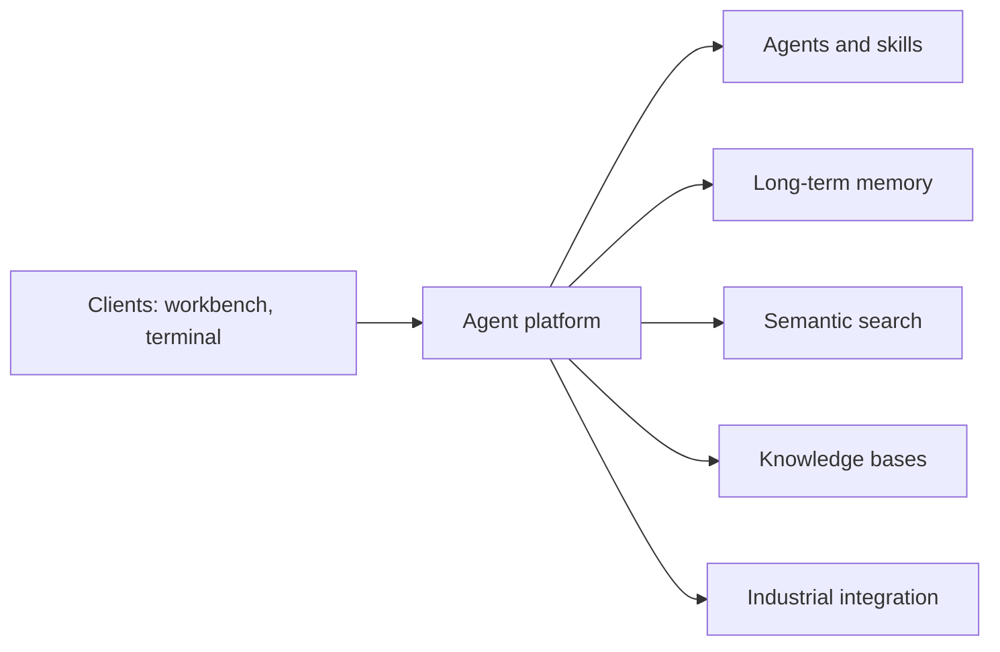

# Entelecheia — Agent Platform and Memory

Entelecheia is the agent platform: it runs the agents, keeps their long-term
memory, answers semantic search, and carries the industrial integration layer.
Arona and Shittim Chest are both consumers of it — the ability to hold a
conversation with memory, or to drive a panel with an agent, comes from here.

## What it does

- **Agents** — specialized agents, each with its own identity, tools and
  skills. A skill chain composes model calls and tool executions into a
  pipeline; before a call runs, the relevant memories and knowledge are
  retrieved and injected into context.
- **Long-term memory** — episodes, entities and artifacts are stored as nodes
  in a memory graph and mirrored into a vector index. Recall combines
  similarity, graph traversal and time decay, and a periodic pass consolidates
  related nodes. Memory survives restarts.
- **Semantic search** — one ranked list over two sources: the workspace index
  (documents, agent reports, knowledge bases) and long-term memory.
- **Knowledge bases** — create a collection, add documents, subscribe agents to
  it; the same search surface retrieves from it.
- **Reflection** — lessons learned are stored and re-injected into later
  prompts, a second, lighter form of persistent memory alongside the graph.
- **Industrial integration** — the write path to real equipment passes through
  this layer, where policy checks and approvals sit.

## How you use it

Clients connect over the platform's JSON-RPC surface with a connection token;
the terminal interface and the chat workbench are both such clients. Running
entelecheia yourself is optional — most deployments are hosted for you.

The agent catalogue, skill authoring and the operational reference belong to
the product; this hub does not duplicate them.

## Where to go deeper

- [Safety Principles](../philosophy/safety.md) — why the model never touches the world.
- [Evernight](./evernight.md) — the layer below, where equipment actually moves.
- [Shittim Chest](./chest.md) — the surface most people meet agents through.
