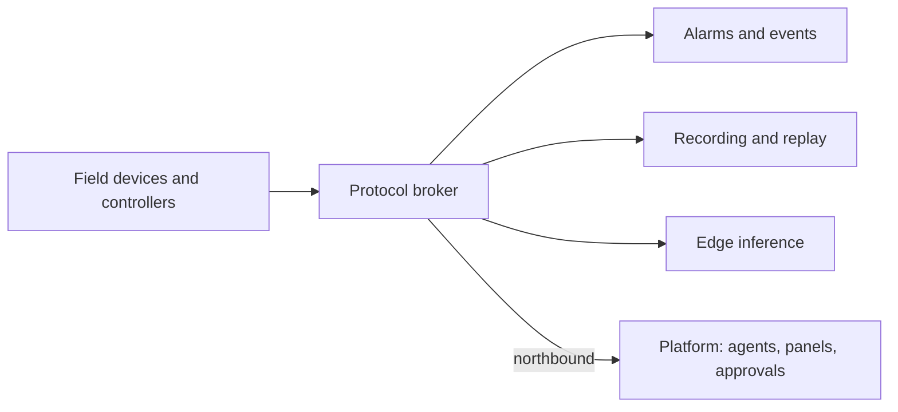

# Evernight — Industrial Protocol Broker

Evernight is the industrial edge: a cross-platform broker that speaks the
protocols found on a real site — Modbus, S7comm, MC Protocol, EtherNet/IP,
EtherCAT, CAN, OPC UA, MQTT — polls sensors, evaluates alarms, and pushes
events up into the platform. It also manages model runtimes on the same node
for inference that stays local.

## What it does

- **Field protocols** — adapters turn the read and the write of each protocol
  into typed readings and commands. Writes are gated: an industrial write needs
  policy validation and human approval upstream before anything moves.
- **Sensing and alarms** — each station polls on its own configurable cycle;
  failures surface as health events rather than silence. Alarm rules evaluate
  readings and emit routed events.
- **Time and recording** — readings carry both a wall-clock and a monotonic
  timestamp, so display and ordering never disagree. The recording pipeline
  keeps a ring buffer and writes segments to disk, and can replay them back
  into the trigger path — the prerequisite for both world state and learning.
- **Edge model serving** — model runtimes are deployed and supervised on the
  node itself, GPU preferred with CPU fallback. This is what makes reactive
  inference independent of an online model.
- **Northbound** — events flow up to the platform over a local socket; device
  and cloud gateways register node identity and telemetry. All physical I/O
  goes through evernight.

## How you use it

On the machine that touches the equipment. Everything above it — agents,
panels, approvals — talks to it through the platform, never to the field bus
directly.

Protocol configuration, the appliance distribution and the driver contract
belong to the product; this hub does not duplicate them.

## Where to go deeper

- [Safety Principles](../philosophy/safety.md) — why writes are gated.
- [Entelecheia](./entelecheia.md) — the layer above, where approvals sit.
- [The Closed Loop](../philosophy/closed-loop.md) — where this segment fits.
