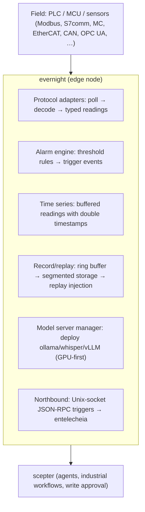

# Evernight — Industrial Protocol Broker

Evernight is the industrial edge: a cross-platform broker that speaks the
field protocols (Modbus, S7comm, MC Protocol, EtherNet/IP, EtherCAT, CAN,
OPC UA, MQTT, …), polls sensors, evaluates alarms, and pushes events into the
celestia-island stack. It also manages on-node model servers (ollama /
whisper / vLLM) for edge inference.

## Architecture at a glance

## 1. Field protocols

Adapters convert each protocol's native read/write into typed readings and
commands. The write path is gated: industrial writes require policy
validation and human approval in the platform (OreXis + approval flows).

## 2. Sensing and alarms

- Polling loops per station with configurable periods; failures surface as
  health events.
- The alarm engine evaluates threshold rules over readings and emits topic
  routed events to the northbound trigger sink.

## 3. Time and recording

Readings carry dual timestamps (wall clock for display/audit, monotonic for
ordering/fusion). A record/replay pipeline keeps a ring buffer, persists
segments, and can inject replayed data back into the trigger pipeline —
the shared prerequisite for the world-state and learning layers.

## 4. Edge model serving

`model_server` manages model runtimes on the node: model deployment on
containers (ollama, whisper.cpp, vLLM) with GPU-first, CPU-fallback
placement — the building block for reactive edge inference that never
depends on an online LLM.

## 5. Northbound integration

Events flow to entelecheia's scepter via a Unix-socket JSON-RPC trigger
sink (topic-routed); the device↔cloud gateway registers node identity and
telemetry. Everything physical routes through evernight.

## Env reference (subset)

| Variable | Purpose |
|---|---|
| `EVERNIGHT_SOCK` | Unix socket for trigger/telemetry to scepter |
| `EVERNIGHT_*` | Per-protocol connection configuration |
| container/GPU env | Model server deployment (ollama/vLLM runtimes) |
