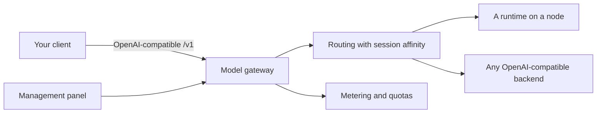

# Arona — Pasarela de modelos y panel de despliegue

Arona es donde los modelos se convierten en algo que la plataforma puede usar:
una pasarela compatible con OpenAI delante de tu propio hardware, más la
consola que la gestiona. Responde a una pregunta — cómo pasa un modelo de
«descargado en algún sitio» a «disponible para todos en la plataforma, medido y
enrutable».

## Qué hace

- **Pasarela** — sirve los endpoints `/v1/*` compatibles con OpenAI, de modo
  que cualquier cliente compatible con OpenAI pueda hablar con los modelos que
  alojas tú mismo.
- **Despliegue** — descarga los pesos del modelo en nodos con GPU, arranca allí
  el runtime y registra el resultado como un backend enrutable. Detener el
  despliegue lo da de baja de nuevo.
- **Enrutado** — los backends se registran como un runtime local o como
  cualquier servicio compatible con OpenAI, se sondean en salud y se enrutan con
  afinidad de sesión. Un backend que no ha pasado su primera sonda de salud se
  rechaza en lugar de probarse.
- **Identidad y medición** — las claves de API autentican `/v1/*`; cada llamada
  se registra por clave con tokens, modelo, backend y coste, y los niveles
  aplican cuotas.

## Cómo se usa

La mayoría de la gente conoce Arona a través del panel: crear una clave de API,
apuntar un modelo a un nodo, vigilar salud y uso. El chat en sí vive en otro
sitio — el banco de trabajo habla con Arona a través de su superficie RPC, y
Arona no incluye ninguna interfaz de chat propia.

La superficie exacta de la API, las recetas de despliegue y la referencia de
configuración pertenecen al producto; este centro no las duplica.

> Desarrollo temprano. Aún no está listo para uso público.

## Para profundizar

- [Shittim Chest](./chest.md) — la superficie que consume Arona.
- [Entelecheia](./entelecheia.md) — la plataforma de agentes detrás del chat.
- [Inicio rápido](../getting-started/quickstart.md) — despliega tu primer modelo.
