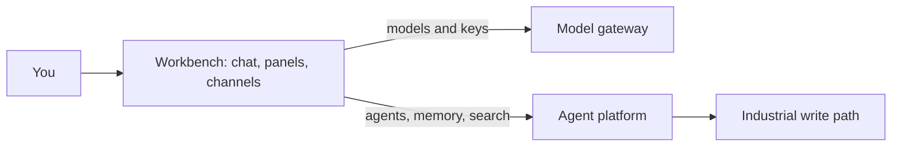

# Shittim Chest — Chat, paneles e integraciones

Shittim Chest es la superficie: chat, paneles e integraciones multicanal — el
lugar donde la capacidad del modelo se convierte en algo que usas a diario. Toma
modelos y memoria de Arona, y agentes, paneles y flujos de trabajo industriales
de entelecheia.

## Qué hace

- **Chat** — las conversaciones se guardan en el servidor con respuestas en
  streaming, de modo que el historial, los pasos de pensamiento y las llamadas a
  herramientas sobreviven a una recarga y a un reinicio.
- **Paneles** — un panel se crea a partir de un solo prompt: el motor genera la
  disposición y los componentes y los persiste en el espacio de trabajo. La
  edición sigue siendo estructural — las vinculaciones de fuentes de datos, las
  listas de componentes y el estado de las conexiones son visibles — en lugar de
  una caja negra. Existen tres tipos: tablas de datos, canalizaciones de medios
  y gemelos 3D de una flota de dispositivos.
- **Canales** — la misma conversación puede llegar desde una plataforma de
  mensajería instantánea y responderse allí, a través de un puente de canales.
- **Búsqueda y conocimiento** — la búsqueda semántica abarca el espacio de
  trabajo y la memoria a largo plazo en una sola lista clasificada, y las bases
  de conocimiento se recuperan desde la misma superficie.
- **Autenticación** — delegada: la pasarela establece quién es el llamador, y
  los roles gobiernan las escrituras sobre paneles y espacios de trabajo.

## Cómo se usa

Como aplicación de escritorio o en el navegador, con una clave de API de Arona.
La webUI es la vía más rápida; la aplicación de escritorio añade el shell nativo.

La referencia de paneles, la configuración de canales y las variables de entorno
pertenecen al producto; este centro no las duplica.

## Para profundizar

- [Arona](./arona.md) — de dónde vienen los modelos, las claves y el uso.
- [Entelecheia](./entelecheia.md) — de dónde vienen los agentes, los paneles y la memoria.
- [Guía de la interfaz web](../webui/guide.md) — la misma historia, pantalla por pantalla.
