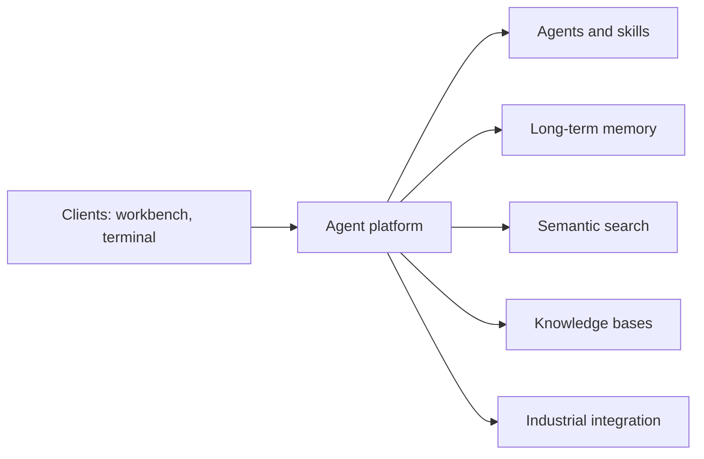

# Entelecheia — Plataforma de agentes y memoria

Entelecheia es la plataforma de agentes: ejecuta los agentes, mantiene su
memoria a largo plazo, responde a la búsqueda semántica y transporta la capa de
integración industrial. Arona y Shittim Chest son ambos consumidores de ella —
la capacidad de mantener una conversación con memoria, o de manejar un panel con
un agente, viene de aquí.

## Qué hace

- **Agentes** — agentes especializados, cada uno con su propia identidad,
  herramientas y habilidades. Una cadena de habilidades compone llamadas a
  modelos y ejecuciones de herramientas en una canalización; antes de que se
  ejecute una llamada, se recuperan las memorias y el conocimiento pertinentes y
  se inyectan en el contexto.
- **Memoria a largo plazo** — los episodios, las entidades y los artefactos se
  guardan como nodos en un grafo de memoria y se replican en un índice
  vectorial. El recuerdo combina similitud, recorrido del grafo y decaimiento
  temporal, y una pasada periódica consolida los nodos relacionados. La memoria
  sobrevive a los reinicios.
- **Búsqueda semántica** — una sola lista clasificada sobre dos fuentes: el
  índice del espacio de trabajo (documentos, informes de agentes, bases de
  conocimiento) y la memoria a largo plazo.
- **Bases de conocimiento** — crea una colección, añade documentos, suscribe
  agentes a ella; la misma superficie de búsqueda recupera de ella.
- **Reflexión** — las lecciones aprendidas se guardan y se reinyectan en los
  prompts posteriores, una segunda forma de memoria persistente, más ligera,
  junto al grafo.
- **Integración industrial** — la ruta de escritura hacia equipos reales pasa
  por esta capa, donde se sitúan las comprobaciones de políticas y las
  aprobaciones.

## Cómo se usa

Los clientes se conectan a través de la superficie JSON-RPC de la plataforma con
un token de conexión; la interfaz de terminal y el banco de trabajo de chat son
ambos clientes de ese tipo. Ejecutar entelecheia tú mismo es opcional — la
mayoría de los despliegues se alojan por ti.

El catálogo de agentes, la autoría de habilidades y la referencia operativa
pertenecen al producto; este centro no las duplica.

## Para profundizar

- [Principios de seguridad](../philosophy/safety.md) — por qué el modelo nunca toca el mundo.
- [Evernight](./evernight.md) — la capa de abajo, donde el equipo se mueve de verdad.
- [Shittim Chest](./chest.md) — la superficie por la que la mayoría conoce a los agentes.
