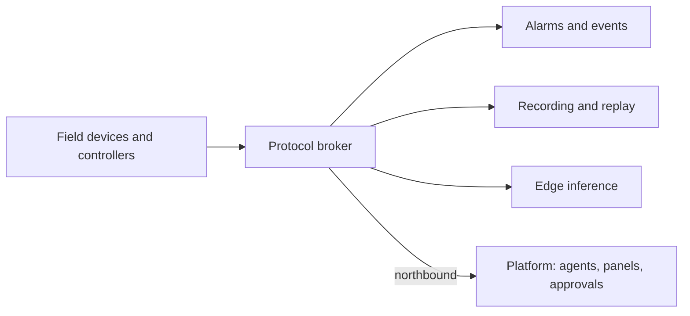

# Evernight — Broker de protocolos industriales

Evernight es el borde industrial: un broker multiplataforma que habla los
protocolos que se encuentran en una planta real — Modbus, S7comm, MC Protocol,
EtherNet/IP, EtherCAT, CAN, OPC UA, MQTT — sondea sensores, evalúa alarmas y
empuja eventos hacia arriba, a la plataforma. También gestiona runtimes de
modelos en el mismo nodo para una inferencia que se queda local.

## Qué hace

- **Protocolos de campo** — los adaptadores convierten la lectura y la escritura
  de cada protocolo en lecturas y comandos tipados. Las escrituras están bajo
  compuerta: una escritura industrial necesita validación de políticas y
  aprobación humana en la plataforma antes de que algo se mueva.
- **Sensado y alarmas** — cada estación sondea en su propio ciclo configurable;
  los fallos afloran como eventos de salud en lugar de silencio. Las reglas de
  alarma evalúan las lecturas y emiten eventos enrutados.
- **Tiempo y grabación** — las lecturas llevan tanto una marca de tiempo de
  reloj de pared como una monótona, de modo que la visualización y la ordenación
  nunca se contradicen. La canalización de grabación mantiene un búfer circular
  y escribe segmentos en disco, y puede reproducirlos de vuelta hacia la ruta de
  disparadores — el prerrequisito tanto del estado del mundo como del
  aprendizaje.
- **Servicio de modelos en el borde** — los runtimes de modelos se despliegan y
  se supervisan en el propio nodo, con preferencia de GPU y respaldo de CPU.
  Esto es lo que hace que la inferencia reactiva sea independiente de tener un
  modelo en línea.
- **Northbound** — los eventos fluyen hacia la plataforma por un socket local;
  las pasarelas de dispositivo y de nube registran la identidad del nodo y la
  telemetría. Toda la E/S física pasa por evernight.

## Cómo se usa

En la máquina que toca el equipo. Todo lo que está por encima — agentes, paneles,
aprobaciones — habla con él a través de la plataforma, nunca directamente con el
bus de campo.

La configuración de protocolos, la distribución del dispositivo y la referencia
de contratos de drivers pertenecen al producto; este centro no las duplica.

## Para profundizar

- [Principios de seguridad](../philosophy/safety.md) — por qué las escrituras están bajo compuerta.
- [Entelecheia](./entelecheia.md) — la capa de arriba, donde se sitúan las aprobaciones.
- [El bucle cerrado](../philosophy/closed-loop.md) — dónde encaja este segmento.
