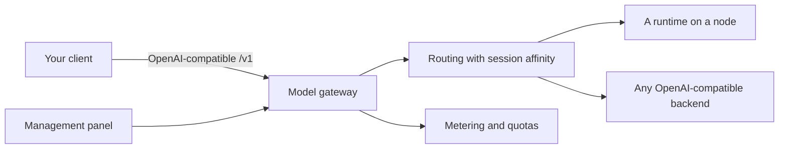

# Arona — Passerelle de modèles et panneau de déploiement

Arona est là où les modèles deviennent utilisables par la plateforme : une
passerelle compatible OpenAI devant votre propre matériel, plus la console qui
la gère. Elle répond à une question — comment un modèle passe-t-il d'«
téléchargé quelque part » à « disponible pour tous sur la plateforme, mesuré et
routable ».

## Ce qu'il fait

- **Passerelle** — sert les endpoints `/v1/*` compatibles OpenAI, afin que
  tout client compatible OpenAI puisse dialoguer avec les modèles que vous
  hébergez vous-même.
- **Déploiement** — télécharge les poids des modèles sur les nœuds GPU, y
  démarre le runtime et enregistre le résultat comme backend routable. Arrêter
  le déploiement le désenregistre à nouveau.
- **Routage** — les backends sont enregistrés comme runtime local ou comme
  n'importe quel service compatible OpenAI, sondés sur leur santé, et routés
  avec affinité de session. Un backend qui n'a pas passé sa première sonde de
  santé est refusé plutôt qu'essayé.
- **Identité et mesure** — les clés API authentifient `/v1/*` ; chaque appel
  est enregistré par clé avec les jetons, le modèle, le backend et le coût, et
  les paliers appliquent des quotas.

## Comment l'utiliser

La plupart des gens rencontrent Arona à travers le panneau : créer une clé API,
pointer un modèle vers un nœud, surveiller la santé et l'usage. Le chat lui-même
vit ailleurs — l'atelier dialogue avec Arona via sa surface RPC, et Arona
n'embarque aucune UI de chat.

La surface d'API exacte, les recettes de déploiement et la référence de
configuration appartiennent au produit ; ce hub ne les duplique pas.

> Développement précoce. Pas encore prêt pour un usage public.

## Pour aller plus loin

- [Shittim Chest](./chest.md) — la surface qui consomme Arona.
- [Entelecheia](./entelecheia.md) — la plateforme d'agents derrière le chat.
- [Démarrage rapide](../getting-started/quickstart.md) — déployez votre premier modèle.
