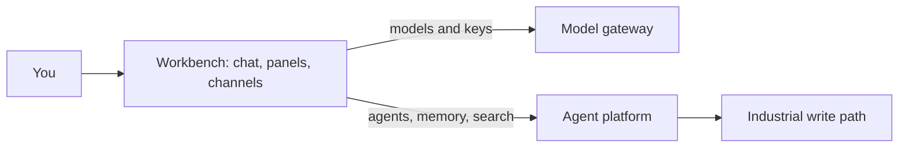

# Shittim Chest — Chat, panneaux et intégrations

Shittim Chest est la surface : chat, panneaux et intégrations multi-canaux — le
lieu où la capacité du modèle devient quelque chose que vous utilisez tous les
jours. Il prend les modèles et la mémoire d'Arona, et les agents, panneaux et
flux de travail industriels d'entelecheia.

## Ce qu'il fait

- **Chat** — les conversations sont persistées côté serveur avec des réponses
  en streaming, afin que l'historique, les étapes de raisonnement et les appels
  d'outils survivent à un rechargement comme à un redémarrage.
- **Panneaux** — un panneau est créé à partir d'un seul prompt : le moteur
  génère la disposition et les composants et les persiste dans l'espace de
  travail. L'édition reste structurelle — liaisons de sources de données,
  listes de composants et état de connexion sont visibles — plutôt qu'une
  boîte noire. Il en existe trois types : tableaux de données, pipelines média
  et jumeaux 3D d'une flotte d'équipements.
- **Canaux** — la même conversation peut arriver depuis une plateforme de
  messagerie instantanée et y être répondue, via un pont de canaux.
- **Recherche et connaissances** — la recherche sémantique couvre l'espace de
  travail et la mémoire long terme en une seule liste classée, et les bases de
  connaissances sont interrogeables depuis la même surface.
- **Auth** — déléguée : la passerelle établit qui est l'appelant, et les rôles
  contrôlent les écritures sur les panneaux et les espaces de travail.

## Comment l'utiliser

Comme application de bureau ou dans le navigateur, avec une clé API d'Arona. La
webUI est le chemin le plus rapide ; l'application de bureau y ajoute le shell
natif.

La référence des panneaux, la configuration des canaux et les variables
d'environnement appartiennent au produit ; ce hub ne les duplique pas.

## Pour aller plus loin

- [Arona](./arona.md) — d'où viennent les modèles, les clés et l'usage.
- [Entelecheia](./entelecheia.md) — d'où viennent les agents, les panneaux et la mémoire.
- [Guide de l'interface Web](../webui/guide.md) — la même histoire, écran par écran.
