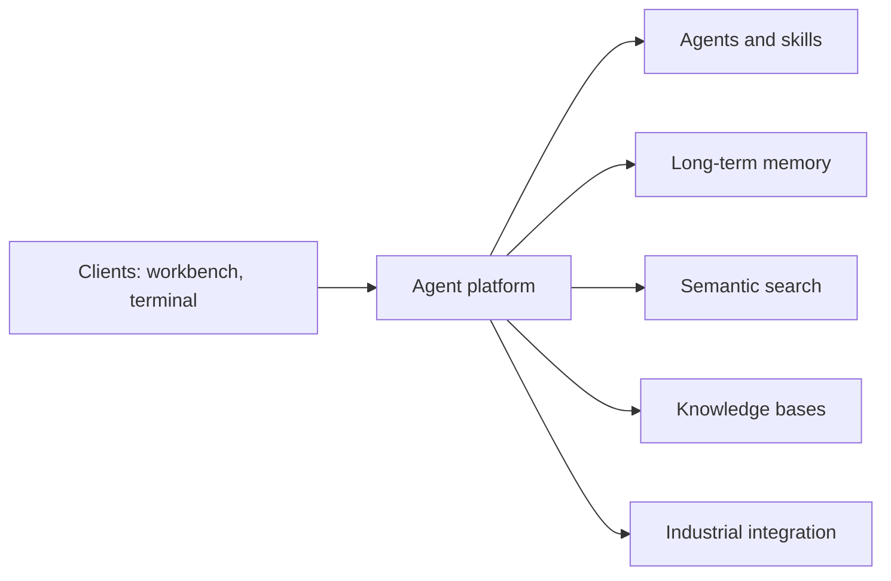

# Entelecheia — Plateforme d'agents et mémoire

Entelecheia est la plateforme d'agents : elle exécute les agents, conserve leur
mémoire long terme, répond à la recherche sémantique et porte la couche
d'intégration industrielle. Arona et Shittim Chest en sont tous deux des
consommateurs — la capacité de tenir une conversation avec mémoire, ou de
piloter un panneau avec un agent, vient d'ici.

## Ce qu'elle fait

- **Agents** — des agents spécialisés, chacun avec sa propre identité, ses
  outils et ses compétences. Une chaîne de compétences compose des appels de
  modèle et des exécutions d'outils en un pipeline ; avant qu'un appel ne
  s'exécute, les mémoires et connaissances pertinentes sont récupérées et
  injectées dans le contexte.
- **Mémoire long terme** — les épisodes, entités et artefacts sont stockés
  comme nœuds dans un graphe de mémoire et reflétés dans un index vectoriel.
  Le rappel combine similarité, traversée de graphe et décroissance temporelle,
  et une passe périodique consolide les nœuds apparentés. La mémoire survit aux
  redémarrages.
- **Recherche sémantique** — une seule liste classée sur deux sources : l'index
  de l'espace de travail (documents, rapports d'agents, bases de connaissances)
  et la mémoire long terme.
- **Bases de connaissances** — créez une collection, ajoutez-y des documents,
  abonnez-y des agents ; la même surface de recherche y puise.
- **Réflexion** — les leçons apprises sont stockées et réinjectées dans les
  prompts ultérieurs, une seconde forme de mémoire persistante, plus légère,
  aux côtés du graphe.
- **Intégration industrielle** — le chemin d'écriture vers les équipements
  réels traverse cette couche, où siègent les vérifications de politique et les
  approbations.

## Comment l'utiliser

Les clients se connectent via la surface JSON-RPC de la plateforme avec un jeton
de connexion ; l'interface terminal et l'atelier de chat sont tous deux de tels
clients. Exécuter entelecheia vous-même est optionnel — la plupart des
déploiements sont hébergés pour vous.

Le catalogue d'agents, l'écriture de compétences et la référence opérationnelle
appartiennent au produit ; ce hub ne les duplique pas.

## Pour aller plus loin

- [Principes de sécurité](../philosophy/safety.md) — pourquoi le modèle ne touche jamais le monde.
- [Evernight](./evernight.md) — la couche du dessous, où les équipements bougent réellement.
- [Shittim Chest](./chest.md) — la surface par laquelle la plupart des gens rencontrent les agents.
