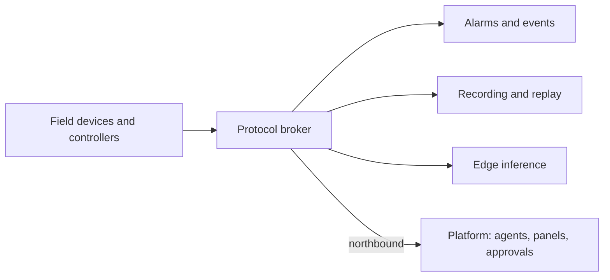

# Evernight — Courtier de protocoles industriels

Evernight est la périphérie industrielle : un courtier multiplateforme qui parle
les protocoles d'un site réel — Modbus, S7comm, MC Protocol, EtherNet/IP,
EtherCAT, CAN, OPC UA, MQTT — interroge les capteurs, évalue les alarmes et
pousse les événements vers la plateforme. Il gère aussi les runtimes de modèles
sur le même nœud, pour une inférence qui reste locale.

## Ce qu'il fait

- **Protocoles de terrain** — les adaptateurs transforment la lecture et
  l'écriture de chaque protocole en lectures et commandes typées. Les écritures
  sont verrouillées : une écriture industrielle exige la validation des
  politiques et l'approbation humaine en amont avant que quoi que ce soit ne
  bouge.
- **Détection et alarmes** — chaque station interroge selon son propre cycle
  configurable ; les échecs se manifestent sous forme d'événements de santé
  plutôt que par le silence. Les règles d'alarme évaluent les lectures et
  émettent des événements routés.
- **Temps et enregistrement** — les lectures portent à la fois un horodatage
  d'horloge murale et un horodatage monotone, afin que l'affichage et
  l'ordonnancement ne se contredisent jamais. Le pipeline d'enregistrement
  maintient un tampon circulaire, écrit des segments sur disque et peut les
  rejouer dans le chemin des déclencheurs — le prérequis partagé de l'état du
  monde et de l'apprentissage.
- **Service de modèles en périphérie** — les runtimes de modèles sont déployés
  et supervisés sur le nœud lui-même, de préférence sur GPU avec repli sur CPU.
  C'est ce qui rend l'inférence réactive indépendante d'un modèle en ligne.
- **Nord (northbound)** — les événements remontent vers la plateforme via une
  socket locale ; les passerelles d'équipements et de cloud enregistrent
  l'identité du nœud et la télémétrie. Toute E/S physique passe par evernight.

## Comment l'utiliser

Sur la machine qui touche les équipements. Tout ce qui se trouve au-dessus —
agents, panneaux, approbations — lui parle via la plateforme, jamais directement
au bus de terrain.

La configuration des protocoles, la distribution d'appliance et la référence des
contrats de pilotes appartiennent au produit ; ce hub ne les duplique pas.

## Pour aller plus loin

- [Principes de sécurité](../philosophy/safety.md) — pourquoi les écritures sont verrouillées.
- [Entelecheia](./entelecheia.md) — la couche du dessus, où siègent les approbations.
- [La Boucle Fermée](../philosophy/closed-loop.md) — où ce segment s'insère.
