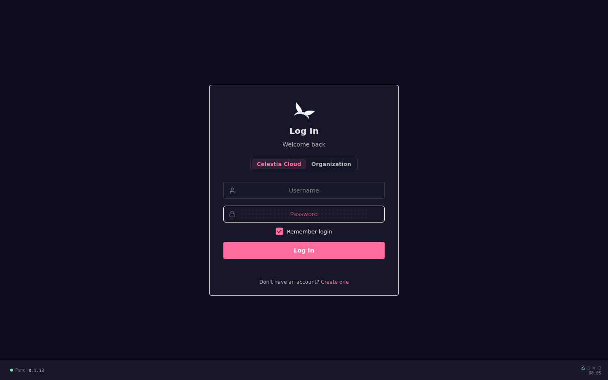

# Web UI — le voyage depuis votre première phrase

Un compte, une clé, une conversation. Cette page suit le même chemin que le
produit — un modèle devient disponible, une clé l'authentifie, un tour
s'exécute avec mémoire, et un panneau en fait quelque chose que vous pouvez
piloter.

## Modèles : de la source à l'invocation

Un modèle passe d'« existant » à « prêt pour le chat » en quatre étapes :
**source** (le catalogue des fournisseurs — des métadonnées, pas d'inférence) →
**enregistrement** (un backend, soit un runtime local, soit tout service
compatible OpenAI ; il survit aux redémarrages) → **déploiement** (un
identifiant de modèle est confié à un nœud, qui le télécharge et démarre le
runtime) → **routage** (équilibrage de charge au moindre nombre de requêtes en
cours, avec affinité de session). Un backend qui n'a pas passé sa première sonde
de santé est refusé plutôt qu'essayé.

## Identité et mesure

Les **clés API** sont votre identité — la passerelle authentifie par jeton
Bearer, et `curl` comme l'atelier en présentent un à l'entrée. L'**usage** est
un registre par appel et par clé : jetons, modèle, backend, coût. Les paliers de
**facturation** fixent des quotas ; en atteindre un est un refus net, pas un
ralentissement.

## Chat et mémoire

Chaque tour passe par le service de mémoire — le badge sur chaque tour vous dit
si c'est le cas. `Memory on` signifie que des mémoires long terme pertinentes
ont été injectées avant le routage ; `Memory offline` signifie que le service de
mémoire est injoignable (un signal d'honnêteté, pas un bug) ; `disabled` signifie
que rien de pertinent n'a été trouvé. Les tours terminés sont extraits et
persistés, ainsi la mémoire survit aux redémarrages — et les entrées de
réécriture peuvent être supprimées directement depuis la page Mémoire.

## Panneaux et contrôle industriel

Un prompt crée un panneau ; le moteur génère la disposition et la persiste dans
l'espace de travail. L'édition est structurelle — liaisons de sources de
données, listes de composants, états de connexion — pas une boîte noire.
Topologie et Holographique sont deux vues de la même flotte ; Rapports ajoute la
recherche sémantique sur l'historique. Les écritures industrielles passent la
validation des politiques et l'**approbation humaine** avant que quoi que ce
soit ne bouge : la fin de la boucle fermée, et sa plus lourde étape.

## Pour aller plus loin

- [Arona](../platforms/arona.md) — la passerelle et le panneau de déploiement.
- [Shittim Chest](../platforms/chest.md) — l'atelier et ses panneaux.
- [Entelecheia](../platforms/entelecheia.md) — agents, espaces de travail et la porte d'écriture industrielle.
