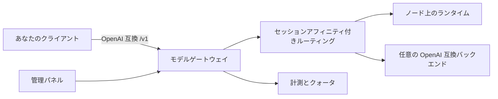

# Arona — モデルゲートウェイとデプロイパネル

Arona は、モデルがプラットフォームで使えるものになる場所です：自分の
ハードウェアの手前に立つ OpenAI 互換ゲートウェイと、それを管理する
コンソール。答えを出す問いは 1 つです —— モデルは「どこかに
ダウンロードされた状態」から、「プラットフォームの誰からも利用でき、
計測され、ルーティング可能な状態」へどうやって進むのか。

## 何をするか

- **ゲートウェイ** —— OpenAI 互換の `/v1/*` エンドポイントを提供するので、
  任意の OpenAI 互換クライアントから、自分でホストするモデルと対話
  できます。
- **デプロイ** —— モデルの重みを GPU ノードにダウンロードし、そこで
  ランタイムを起動し、その結果をルーティング可能なバックエンドとして
  登録します。デプロイを停止すると、その登録も解除されます。
- **ルーティング** —— バックエンドはローカルランタイムまたは任意の
  OpenAI 互換サービスとして登録され、ヘルスプローブされ、セッション
  アフィニティ付きでルーティングされます。最初のヘルスプローブに合格
  していないバックエンドは、試されるのではなく拒否されます。
- **アイデンティティと計測** —— API キーが `/v1/*` を認証します。すべての
  呼び出しはキーごとにトークン数、モデル、バックエンド、コストとともに
  記録され、ティアがクォータを執行します。

## 使い方

多くの人はパネルを通じて Arona に出会います：API キーを作成し、モデルを
ノードに向け、ヘルスと利用状況を見守ります。チャット自体は別の場所に
あります —— ワークベンチは Arona の RPC サーフェス越しに Arona と対話し、
Arona 自身はチャット UI を持ちません。

正確な API サーフェス、デプロイのレシピ、設定リファレンスは製品に
属しており、このハブでは重複して書きません。

> 開発初期です。公開利用にはまだ準備できていません。

## さらに詳しく

- [Shittim Chest](./chest.md) —— Arona を利用するサーフェス。
- [Entelecheia](./entelecheia.md) —— チャットの背後にあるエージェントプラットフォーム。
- [クイックスタート](../getting-started/quickstart.md) —— 最初のモデルをデプロイする。
