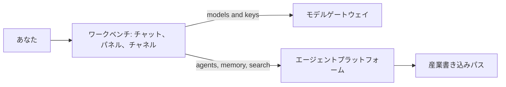

# Shittim Chest — チャット、パネル、統合

Shittim Chest はユーザーの顔です: チャット、パネル、マルチチャネル統合 ——
モデルの能力を、毎日使うものに変える場所です。モデルと
メモリは Arona から、エージェント、パネル、産業ワークフローは entelecheia
から受け取ります。

## 何をするか

- **チャット** —— 会話はストリーミングレスポンスとともにサーバー側で
  永続化されるため、履歴、思考ステップ、ツール呼び出しはリロードや
  再起動を越えて保持されます。
- **パネル** —— パネルは 1 つのプロンプトから作成されます: エンジンが
  レイアウトとコンポーネントを生成し、ワークスペースへ永続化します。
  編集は構造的なままであり、ブラックボックスではありません:
  データソースのバインディング、コンポーネント一覧、接続状態が可視です。
  3 種類があります: データテーブル、メディアパイプライン、デバイス
  フリートの 3D ツイン。
- **チャネル** —— 同じ会話が、インスタントメッセージングのプラットフォーム
  から届き、チャネルブリッジを通じてそこで回答できます。
- **検索とナレッジ** —— セマンティック検索はワークスペースと長期メモリを
  1 つのランキングリストで横断し、ナレッジベースは同じサーフェスから
  取得できます。
- **認証** —— 委任されます: ゲートウェイが呼び出し元が誰かを確立し、
  ロールがパネルとワークスペースへの書き込みをゲートします。

## 使い方

Arona で発行した API キーを使って、デスクトップアプリまたはブラウザで
使います。WebUI が最も速い入口で、デスクトップアプリはネイティブシェルを
追加します。

パネルのリファレンス、チャネル設定、環境変数は製品に属しており、
このハブでは重複して書きません。

## さらに詳しく

- [Arona](./arona.md) —— モデル、キー、利用記録の出どころ。
- [Entelecheia](./entelecheia.md) —— エージェント、パネル、メモリの出どころ。
- [Web UI ガイド](../webui/guide.md) —— 同じ物語を、画面ごとに。
