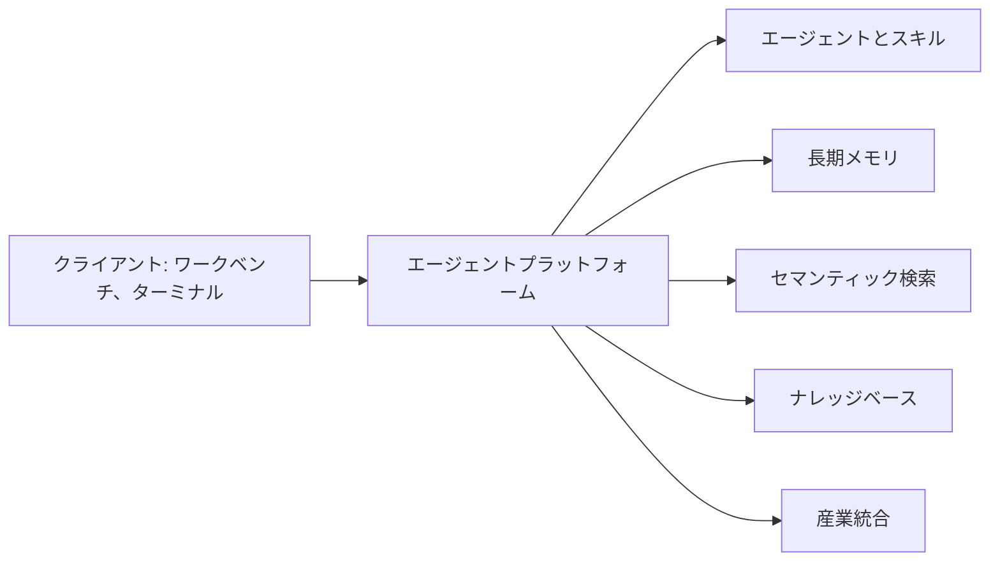

# Entelecheia — エージェントプラットフォームとメモリ

Entelecheia はエージェントプラットフォームです: エージェントを実行し、
その長期メモリを維持し、セマンティック検索に答え、産業統合レイヤを
担います。Arona と Shittim Chest はどちらもその利用者です —— メモリを
伴う会話を保持する能力も、エージェントでパネルを動かす能力も、ここから
来ます。

## 何をするか

- **エージェント** —— 特化エージェントで、それぞれが独自のアイデンティ
  ティ、ツール、スキルを持ちます。スキルチェーンはモデル呼び出しとツール
  実行を 1 つのパイプラインに組み上げます。呼び出しが実行される前に、
  関連するメモリとナレッジが取得され、コンテキストへ注入されます。
- **長期メモリ** —— エピソード、エンティティ、アーティファクトはメモリ
  グラフのノードとして保存され、ベクトルインデックスへミラーされます。
  呼び出しは類似度、グラフ走査、時間減衰を組み合わせ、定期的な処理が
  関連ノードを統合します。メモリは再起動を越えて存続します。
- **セマンティック検索** —— 2 つのソース（ワークスペースインデックス
  （ドキュメント、エージェントレポート、ナレッジベース）と長期メモリ）を
  1 つのランキングリストにまとめます。
- **ナレッジベース** —— コレクションを作成し、ドキュメントを追加し、
  エージェントを購読させます。同じ検索サーフェスから取得できます。
- **リフレクション** —— 得られた教訓は保存され、後のプロンプトへ再注入
  されます。グラフと並ぶ、2 番目の軽量な永続メモリです。
- **産業統合** —— 実機器への書き込みパスはこのレイヤを通り、ポリシー
  チェックと承認がここにあります。

## 使い方

クライアントは接続トークンを使って、プラットフォームの JSON-RPC サーフェス
経由で接続します。ターミナルインターフェースとチャットワークベンチは
どちらもそのようなクライアントです。entelecheia 自身を運用するかは任意です
—— ほとんどのデプロイメントはホストされたものが提供されます。

エージェントカタログ、スキルの執筆、運用リファレンスは製品に属して
おり、このハブでは重複して書きません。

## さらに詳しく

- [安全の原則](../philosophy/safety.md) —— モデルが決して世界に触れない理由。
- [Evernight](./evernight.md) —— 下のレイヤ。機器が実際に動く場所。
- [Shittim Chest](./chest.md) —— ほとんどの人がエージェントと出会うサーフェス。
