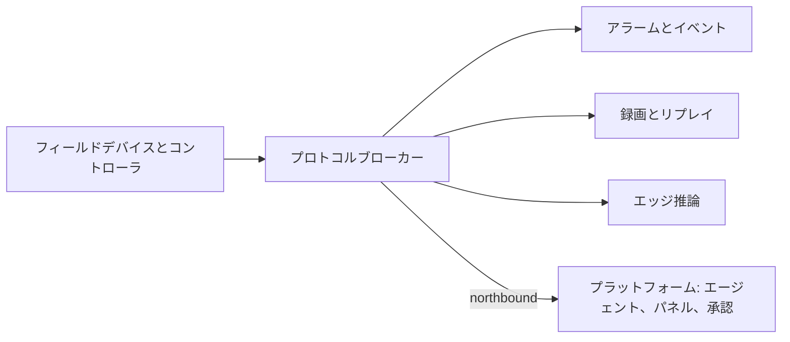

# Evernight — 産業プロトコルブローカー

Evernight は産業エッジです: 実際の現場に存在するプロトコル（Modbus、
S7comm、MC Protocol、EtherNet/IP、EtherCAT、CAN、OPC UA、MQTT）を話す
クロスプラットフォームのブローカーであり、センサーをポーリングし、
アラームを評価し、イベントをプラットフォームへプッシュします。また、
推論をローカルに留めるために、同じノード上のモデルランタイムも管理
します。

## 何をするか

- **フィールドプロトコル** —— アダプタは各プロトコル固有の読み書きを、
  型付きの読み取り値とコマンドへ変換します。書き込みパスはゲートされて
  います: 産業への書き込みには、何かが動く前に上流でのポリシー検証と
  人間の承認が必要です。
- **センシングとアラーム** —— ステーションごとに、設定可能な独自の周期で
  ポーリングします。失敗は沈黙ではなくヘルスイベントとして表面化します。
  アラームルールは読み取り値を評価し、ルーティングされたイベントを送出
  します。
- **時刻と録画** —— 読み取り値は壁時計と単調時計の両方のタイムスタンプを
  運ぶため、表示と順序付けが食い違うことはありません。録画パイプラインは
  リングバッファを保持し、セグメントをディスクへ書き出し、トリガー
  パイプラインへ再注入することもできます —— 世界状態と学習の両方の
  前提です。
- **エッジモデルサービング** —— モデルランタイムはノード上にデプロイされ
  監視されます。GPU 優先で、CPU へのフォールバックがあります。これにより、
  リアクティブな推論がオンラインのモデルから独立します。
- **ノースバウンド** —— イベントはローカルソケットを介してプラットフォーム
  へ流れます。デバイスとクラウドのゲートウェイがノードのアイデンティティと
  テレメトリを登録します。物理的な I/O はすべて evernight を通ります。

## 使い方

機器に触れるマシンの上で動かします。その上のものはすべて —— エージェント、
パネル、承認 —— がプラットフォームを通じて evernight と対話し、フィールド
バスへ直接話しかけることはありません。

プロトコルの設定、アプライアンスの配布、ドライバの契約は製品に
属しており、このハブでは重複して書きません。

## さらに詳しく

- [安全の原則](../philosophy/safety.md) —— 書き込みがゲートされる理由。
- [Entelecheia](./entelecheia.md) —— 上のレイヤ。承認が置かれる場所。
- [クローズドループ](../philosophy/closed-loop.md) —— この区間が収まる場所。
