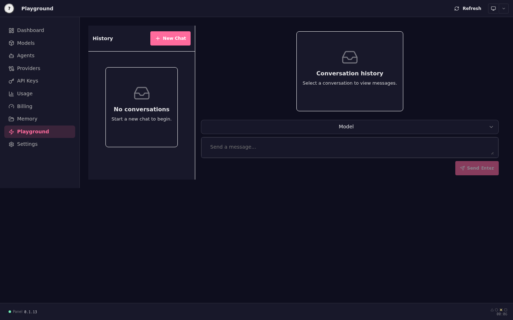

# Web UI — 最初の一文から始まる旅

1 つのアカウント、1 つのキー、1 つの会話です。このページは製品と同じ
道を歩きます —— モデルが利用可能になり、キーがそれを認証し、メモリを
伴って 1 ターンが走り、パネルがそれを操作できるものに変えるまで。

## モデル：ソースから呼び出しまで

モデルは「存在する」から「チャットできる」まで、四つの段階を旅します：
**ソース**（プロバイダのカタログ —— 推論ではなくメタデータ）→
**登録**（バックエンド。ローカルランタイムまたは任意の OpenAI 互換
サービスであり、再起動を越えて保持される）→ **デプロイ**（モデル ID が
ノードへ渡され、ノードがそれをダウンロードしてランタイムを起動する）→
**ルーティング**（セッションアフィニティ付きの least-in-flight ロード
バランシング）。最初のヘルスプローブに合格していないバックエンドは、
試されるのではなく拒否されます。

## アイデンティティと従量課金

**API キー**はあなたのアイデンティティです —— ゲートウェイは Bearer
トークンで認証し、`curl` もワークベンチも入り口でそれを提示します。
**Usage** はキーごと・呼び出しごとの台帳です：トークン数、モデル、
バックエンド、コスト。**Billing** のティアはクォータを定めます。上限に
達したときに返ってくるのは、緩やかな減速ではなく明確な拒絶です。

## チャットとメモリ

すべてのターンはメモリサービスを通ります —— 各ターンのバッジが、
実際に通ったかどうかを告げています。`Memory on` は、ルーティングの前に
関連する長期メモリが注入されたことを、`Memory offline` はメモリサービスに
到達できないことを（バグではなく正直さのシグナル）、`disabled` は関連する
ものが見つからなかったことを意味します。完了したターンは抽出され永続化
されるため、メモリは再起動を越えて存続します ——
書き戻されたエントリは Memory ページから直接削除できます。

## パネルと産業制御

一つのプロンプトがパネルを生みます。エンジンがレイアウトを生成し、
ワークスペースへ永続化します。編集は構造的です ——
データソースのバインディング、コンポーネント一覧、接続状態。
ブラックボックスではありません。Topology と Holographic は同じフリートを
映す二つのビューであり、Reports が履歴へのセマンティック検索を加えます。
産業への書き込みは、何かが動く前にポリシー検証と**人間の承認**を通ります：
クローズドループの終点、そして最も重い一歩です。

## さらに詳しく

- [Arona](../platforms/arona.md) —— ゲートウェイとデプロイパネル。
- [Shittim Chest](../platforms/chest.md) —— ワークベンチとそのパネル。
- [Entelecheia](../platforms/entelecheia.md) —— エージェント、ワークスペース、産業書き込みゲート。
