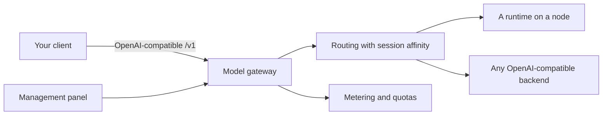

# Arona — 모델 게이트웨이 및 배포 패널

Arona는 모델이 플랫폼이 쓸 수 있는 무언가가 되는 곳입니다: 자체 하드웨어 앞에
놓인 OpenAI 호환 게이트웨이와, 그것을 관리하는 콘솔입니다. 한 가지 질문에
답합니다 — 모델은 어떻게 "어딘가에 내려받힌" 상태에서 "플랫폼의 모든
사람이 쓸 수 있고, 계량되고, 라우팅 가능한" 상태가 되는가.

## 하는 일

- **게이트웨이** — OpenAI 호환 `/v1/*` 엔드포인트를 제공하므로, 어떤
  OpenAI 호환 클라이언트든 직접 호스팅한 모델과 대화할 수 있습니다.
- **배포** — 모델 가중치를 GPU 노드로 내려받아 그곳에서 런타임을 시작하고,
  결과를 라우팅 가능한 백엔드로 등록합니다. 배포를 중지하면 다시
  등록이 해제됩니다.
- **라우팅** — 백엔드는 로컬 런타임 또는 임의의 OpenAI 호환 서비스로
  등록되고, 헬스 프로브를 거친 뒤 세션 친화성으로 라우팅됩니다. 첫 헬스
  프로브를 통과하지 못한 백엔드는 시도되지 않고 거부됩니다.
- **신원과 계량** — API key가 `/v1/*`를 인증합니다; 모든 호출은 키별로
  토큰, 모델, 백엔드, 비용과 함께 기록되며, 등급(tier)이 할당량을
  적용합니다.

## 사용 방법

대부분의 사람은 패널을 통해 Arona를 만납니다: API key를 만들고, 모델을
노드에 지정하고, 헬스와 사용량을 확인합니다. 채팅 자체는 다른 곳에
있습니다 — 워크벤치가 RPC 표면을 통해 Arona와 대화하며, Arona는 자체 채팅
UI를 제공하지 않습니다.

정확한 API 표면, 배포 레시피, 설정 참조는 제품에 속하며 이 허브는 그것을
중복하지 않습니다.

> 초기 개발 단계입니다. 아직 공개 사용에 적합하지 않습니다.

## 더 알아보기

- [Shittim Chest](./chest.md) — Arona를 소비하는 표면.
- [Entelecheia](./entelecheia.md) — 채팅 뒤의 에이전트 플랫폼.
- [빠른 시작](../getting-started/quickstart.md) — 첫 모델을 배포하기.
