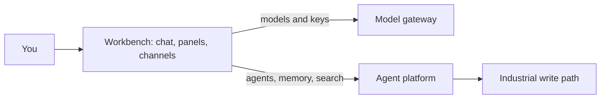

# Shittim Chest — 채팅, 패널 및 연동

Shittim Chest는 표면입니다: 채팅, 패널, 다중 채널 연동 — 모델의 능력이
매일 쓰는 무언가가 되는 곳입니다. Arona에서 모델과 메모리를, entelecheia에서
에이전트와 패널, 산업 워크플로를 가져옵니다.

## 하는 일

- **채팅** — 대화는 스트리밍 응답과 함께 서버 측에 유지되므로, 기록과 사고
  단계, 도구 호출이 새로고침과 재시작을 거쳐도 남습니다.
- **패널** — 패널은 프롬프트 하나로 만들어집니다: 엔진이 레이아웃과
  컴포넌트를 생성하고 워크스페이스에 유지합니다. 편집은 블랙박스가 아니라
  구조적입니다 — 데이터 소스 바인딩, 컴포넌트 목록, 연결 상태가 보입니다.
  세 가지 종류가 있습니다: 데이터 표, 미디어 파이프라인, 장치 플리트의
  3D 트윈.
- **채널** — 같은 대화가 인스턴트 메시징 플랫폼에서 도착해 그곳에서
  답변될 수 있습니다. 채널 브리지를 통해서입니다.
- **검색과 지식** — 시맨틱 검색은 워크스페이스와 장기 메모리를 하나의
  순위 목록으로 아우르고, 지식 베이스도 같은 표면에서 검색됩니다.
- **인증** — 위임됩니다: 게이트웨이가 호출자가 누구인지 확립하고, 역할이
  패널과 워크스페이스에 대한 쓰기를 제한합니다.

## 사용 방법

Arona에서 받은 API key로 데스크톱 앱 또는 브라우저에서 사용합니다. 웹UI가
가장 빠른 진입 경로이고, 데스크톱 앱은 네이티브 셸을 더합니다.

패널 참조, 채널 설정, 환경 변수는 제품에 속하며 이 허브는 그것을 중복하지
않습니다.

## 더 알아보기

- [Arona](./arona.md) — 모델, 키, 사용량이 오는 곳.
- [Entelecheia](./entelecheia.md) — 에이전트, 패널, 메모리가 오는 곳.
- [Web UI 가이드](../webui/guide.md) — 같은 이야기를 화면별로.
