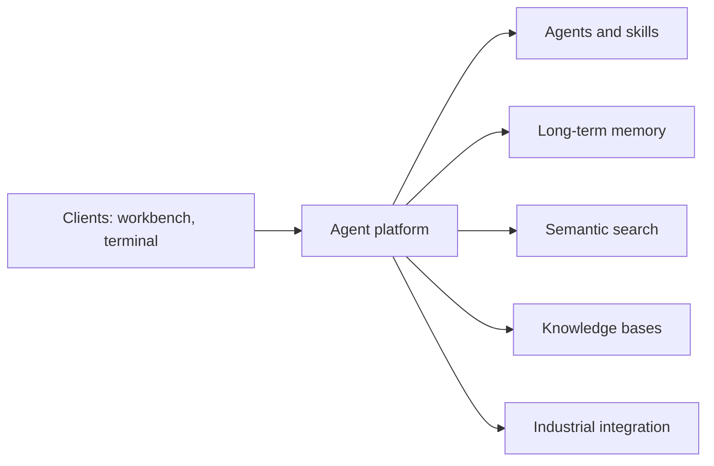

# Entelecheia — 에이전트 플랫폼 및 메모리

Entelecheia는 에이전트 플랫폼입니다: 에이전트를 실행하고, 장기 메모리를
유지하고, 시맨틱 검색에 답하고, 산업 연동 계층을 담당합니다. Arona와
Shittim Chest 모두 이 플랫폼의 소비자입니다 — 메모리와 함께 대화를 나누는
능력, 에이전트로 패널을 구동하는 능력이 여기에서 옵니다.

## 하는 일

- **에이전트** — 각자 고유한 신원과 도구, 스킬을 가진 특화된 에이전트.
  스킬 체인은 모델 호출과 도구 실행을 하나의 파이프라인으로 조합하며,
  호출이 실행되기 전에 관련 메모리와 지식이 검색되어 컨텍스트에
  주입됩니다.
- **장기 메모리** — 에피소드, 엔티티, 아티팩트가 메모리 그래프의 노드로
  저장되고 벡터 인덱스로 미러링됩니다. 회수는 유사도, 그래프 순회, 시간
  감쇠를 결합하며, 주기적인 패스가 관련 노드를 통합합니다. 메모리는
  재시작을 거쳐도 유지됩니다.
- **시맨틱 검색** — 두 소스를 아우르는 하나의 순위 목록: 워크스페이스
  인덱스(문서, 에이전트 리포트, 지식 베이스)와 장기 메모리.
- **지식 베이스** — 컬렉션을 만들고 문서를 추가하고 에이전트를 구독시키면,
  같은 검색 표면에서 검색됩니다.
- **리플렉션** — 배운 교훈이 저장되어 이후 프롬프트에 다시 주입되며, 그래프와
  나란히 놓이는 두 번째의 더 가벼운 형태의 영속 메모리입니다.
- **산업 연동** — 실제 장비로 향하는 쓰기 경로가 이 계층을 지나며, 정책 검사와
  승인이 여기에 있습니다.

## 사용 방법

클라이언트는 연결 토큰과 함께 플랫폼의 JSON-RPC 표면으로 연결합니다; 터미널
인터페이스와 채팅 워크벤치 모두 그런 클라이언트입니다. entelecheia를 직접
운영하는 것은 선택 사항입니다 — 대부분의 배포는 당신을 위해 호스팅됩니다.

에이전트 카탈로그, 스킬 작성, 운영 참조는 제품에 속하며 이 허브는 그것을
중복하지 않습니다.

## 더 알아보기

- [안전 원칙](../philosophy/safety.md) — 모델이 세계를 직접 건드리지 않는 이유.
- [Evernight](./evernight.md) — 장비가 실제로 움직이는 아래 계층.
- [Shittim Chest](./chest.md) — 대부분의 사람이 에이전트를 만나는 표면.
