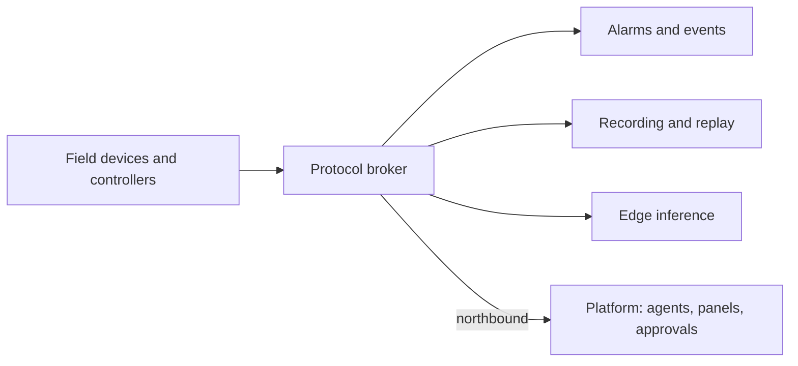

# Evernight — 산업 프로토콜 브로커

Evernight는 산업 엣지입니다: 실제 현장에서 쓰이는 프로토콜 — Modbus, S7comm,
MC Protocol, EtherNet/IP, EtherCAT, CAN, OPC UA, MQTT — 을 구사하는
크로스 플랫폼 브로커로, 센서를 폴링하고, 알람을 평가하고, 이벤트를 플랫폼으로
밀어 올립니다. 또한 로컬에 머무는 추론을 위해 같은 노드의 모델 런타임도
관리합니다.

## 하는 일

- **필드 프로토콜** — 어댑터가 각 프로토콜의 읽기와 쓰기를 타입이 지정된
  판독값과 명령으로 바꿉니다. 쓰기에는 게이트가 있습니다: 산업 쓰기는
  무언가가 움직이기 전에 상위에서 정책 검증과 사람의 승인을 받아야 합니다.
- **센싱과 알람** — 각 스테이션은 자체 설정 가능한 주기로 폴링합니다; 실패는
  침묵이 아니라 헬스 이벤트로 드러납니다. 알람 규칙은 판독값을 평가하고
  라우팅된 이벤트를 내보냅니다.
- **시간과 기록** — 판독값은 벽시계 시각과 단조 시각을 모두 지니므로, 표시와
  정렬이 어긋나는 일이 없습니다. 기록 파이프라인은 링 버퍼를 유지하고
  세그먼트를 디스크에 쓰며, 그것을 트리거 경로로 다시 재생할 수 있습니다 —
  세계 상태와 학습 모두의 전제 조건입니다.
- **엣지 모델 서빙** — 모델 런타임은 노드 자체에서 배포되고 감독되며, GPU를
  우선하고 CPU로 폴백합니다. 이것이 반응형 추론을 온라인 모델로부터
  독립적으로 만듭니다.
- **노스바운드** — 이벤트는 로컬 소켓을 통해 플랫폼으로 올라갑니다; 장치 및
  클라우드 게이트웨이가 노드 신원과 텔레메트리를 등록합니다. 모든 물리적
  I/O는 evernight를 통과합니다.

## 사용 방법

장비에 닿아 있는 기계 위에서 사용합니다. 그 위의 모든 것 — 에이전트, 패널,
승인 — 은 플랫폼을 통해 이야기하며, 필드 버스와 직접 대화하지 않습니다.

프로토콜 설정, 어플라이언스 배포판, 드라이버 계약은 제품에 속하며 이 허브는
그것을 중복하지 않습니다.

## 더 알아보기

- [안전 원칙](../philosophy/safety.md) — 쓰기에 게이트가 있는 이유.
- [Entelecheia](./entelecheia.md) — 승인이 놓이는 위 계층.
- [폐쇄 루프](../philosophy/closed-loop.md) — 이 구간이 들어맞는 위치.
