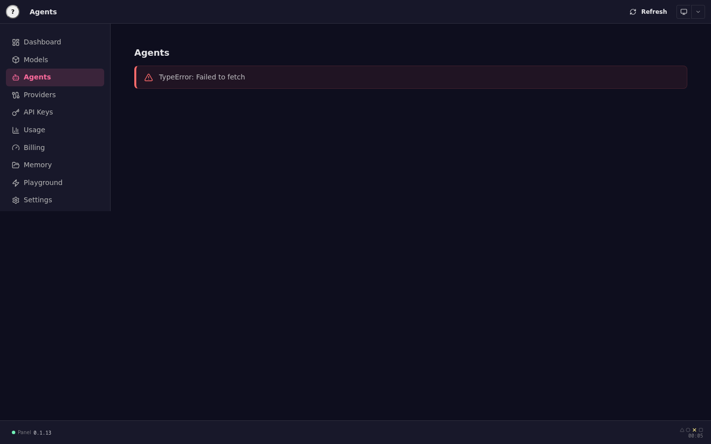

# Web UI — 첫 문장에서 시작하는 여정

계정 하나, 키 하나, 대화 하나. 이 페이지는 제품이 걷는 것과 같은 길을
걷습니다 — 모델이 사용 가능해지고, 키가 그것을 인증하고, 한 턴이 메모리와
함께 실행되고, 패널이 그것을 운영할 수 있는 무언가로 바꿉니다.

## 모델: 소스에서 호출까지

모델은 "존재함"에서 "채팅 가능"까지 네 단계를 거칩니다: **소스**(제공자
카탈로그 — 추론이 아닌 메타데이터) → **등록**(로컬 런타임 또는 임의의
OpenAI 호환 서비스를 백엔드로; 재시작을 거쳐도 유지) → **배포**(모델 ID를
노드에 넘기면 노드가 내려받고 런타임을 시작) → **라우팅**(세션 친화성을 갖춘
최소 진행 중(in-flight) 부하 분산). 첫 헬스 프로브를 통과하지 못한
백엔드는 시도되지 않고 거부됩니다.

## 신원과 계량

**API key**는 당신의 신원입니다 — 게이트웨이는 Bearer 토큰으로 인증하며,
`curl`과 워크벤치 모두 문 앞에서 그것을 제시합니다. **사용량**은 키별
호출당 원장입니다: 토큰, 모델, 백엔드, 비용. **과금** 등급(tier)은 할당량을
설정합니다; 하나에 도달하면 느려지는 것이 아니라 단호한 거부입니다.

## 채팅과 메모리

모든 턴은 메모리 서비스를 거칩니다 — 각 턴의 배지가 그랬는지 알려줍니다.
`Memory on`은 라우팅 전에 관련 장기 메모리가 주입되었다는 뜻입니다;
`Memory offline`은 메모리 서비스에 도달할 수 없다는 뜻이며(버그가 아니라
정직성 신호), `disabled`는 관련된 것이 없었다는 뜻입니다. 완료된 턴은
추출되어 유지되므로, 메모리는 재시작을 거쳐도 남습니다 — 그리고 쓰기 반영
항목은 메모리 페이지에서 직접 삭제할 수 있습니다.

## 패널과 산업 제어

프롬프트 하나가 패널을 만듭니다; 엔진이 레이아웃을 생성하고 워크스페이스에
유지합니다. 편집은 구조적입니다 — 데이터 소스 바인딩, 컴포넌트 목록, 연결
상태 — 블랙박스가 아닙니다. Topology와 Holographic은 같은 플리트의 두 가지
보기이며, Reports는 이력에 대한 시맨틱 검색을 더합니다. 산업 쓰기는 무언가가
움직이기 전에 정책 검증과 **사람의 승인**을 통과합니다: 폐쇄 루프의 끝이자,
그중 가장 무거운 단계입니다.

## 더 알아보기

- [Arona](../platforms/arona.md) — 게이트웨이와 배포 패널.
- [Shittim Chest](../platforms/chest.md) — 워크벤치와 그 패널들.
- [Entelecheia](../platforms/entelecheia.md) — 에이전트, 워크스페이스, 산업 쓰기 게이트.
