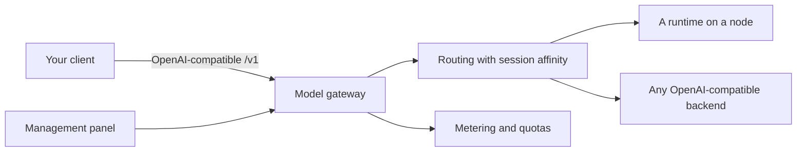

# Arona — Gateway de Modelos e Painel de Implantação

A Arona é onde os modelos se tornam algo que a plataforma consegue usar: um
gateway compatível com OpenAI na frente do seu próprio hardware, mais o console
que o gerencia. Ela responde a uma pergunta — como um modelo sai de "baixado em
algum lugar" para "disponível para todos na plataforma, medido e roteável".

## O que ela faz

- **Gateway** — serve os endpoints `/v1/*` compatíveis com OpenAI, para que
  qualquer cliente compatível com OpenAI possa conversar com modelos que você
  mesmo hospeda.
- **Implantação** — baixa os pesos do modelo para nós com GPU, inicia o runtime
  ali e registra o resultado como um backend roteável. Parar a implantação
  desregistra o backend novamente.
- **Roteamento** — os backends são registrados como um runtime local ou como
  qualquer serviço compatível com OpenAI, passam por sonda de saúde e recebem
  tráfego com afinidade de sessão. Um backend que ainda não passou pela primeira
  sonda de saúde é recusado em vez de testado.
- **Identidade e medição** — as chaves de API autenticam `/v1/*`; cada chamada
  é registrada por chave com tokens, modelo, backend e custo, e os níveis
  aplicam cotas.

## Como você a usa

A maioria das pessoas conhece a Arona pelo painel: crie uma API key, aponte um
modelo para um nó, acompanhe saúde e uso. O chat em si mora em outro lugar — a
bancada fala com a Arona pela sua superfície RPC, e a Arona não traz UI de chat
própria.

A superfície exata da API, as receitas de implantação e a referência de
configuração pertencem ao produto; este hub não as duplica.

> Desenvolvimento inicial. Ainda não pronto para uso público.

## Aprofundar-se

- [Shittim Chest](./chest.md) — a superfície que consome a Arona.
- [Entelecheia](./entelecheia.md) — a plataforma de agentes por trás do chat.
- [Início Rápido](../getting-started/quickstart.md) — implante o seu primeiro modelo.
