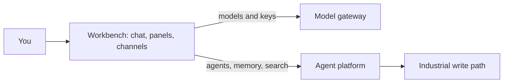

# Shittim Chest — Chat, Painéis e Integrações

O Shittim Chest é a superfície: chat, painéis e integrações multicanal — o
lugar onde a capacidade do modelo se torna algo que você usa todos os dias. Ele
recebe modelos e memória da Arona, e agentes, painéis e fluxos de trabalho
industriais da entelecheia.

## O que ele faz

- **Chat** — as conversas são persistidas no servidor com respostas em
  streaming, então histórico, etapas de raciocínio e chamadas de ferramentas
  sobrevivem a um recarregamento e a um reinício.
- **Painéis** — um painel é criado a partir de um único prompt: o motor gera o
  layout e os componentes e os persiste no workspace. A edição permanece
  estrutural — vínculos de fonte de dados, listas de componentes e estado de
  conexão ficam visíveis — em vez de uma caixa-preta. Existem três tipos:
  tabelas de dados, pipelines de mídia e gêmeos 3D de uma frota de
  dispositivos.
- **Canais** — a mesma conversa pode chegar de uma plataforma de mensagens
  instantâneas e ser respondida ali, por meio de uma ponte de canais.
- **Busca e conhecimento** — a busca semântica percorre o workspace e a memória
  de longo prazo numa única lista ranqueada, e as bases de conhecimento são
  recuperáveis a partir da mesma superfície.
- **Auth** — delegada: o gateway estabelece quem é o chamador, e os papéis
  controlam as escritas em painéis e workspaces.

## Como você o usa

Como aplicativo desktop ou no navegador, com uma API key da Arona. O webUI é o
caminho mais rápido; o aplicativo desktop acrescenta o shell nativo.

A referência de painéis, a configuração de canais e as variáveis de ambiente
pertencem ao produto; este hub não as duplica.

## Aprofundar-se

- [Arona](./arona.md) — de onde vêm modelos, chaves e uso.
- [Entelecheia](./entelecheia.md) — de onde vêm agentes, painéis e memória.
- [Guia da web UI](../webui/guide.md) — a mesma história, tela por tela.
