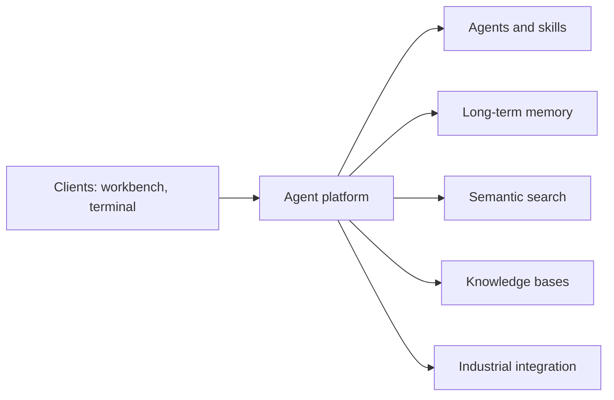

# Entelecheia — Plataforma de Agentes e Memória

A Entelecheia é a plataforma de agentes: ela executa os agentes, mantém a
memória de longo prazo deles, responde à busca semântica e carrega a camada de
integração industrial. A Arona e o Shittim Chest são ambos consumidores dela — a
capacidade de manter uma conversa com memória, ou de conduzir um painel com um
agente, vem daqui.

## O que ela faz

- **Agentes** — agentes especializados, cada um com a sua própria identidade,
  ferramentas e habilidades. Uma cadeia de habilidades compõe chamadas de modelo
  e execuções de ferramentas num pipeline; antes de uma chamada rodar, as
  memórias e o conhecimento relevantes são recuperados e injetados no contexto.
- **Memória de longo prazo** — episódios, entidades e artefatos são armazenados
  como nós num grafo de memória e espelhados num índice vetorial. O recall
  combina similaridade, travessia do grafo e decaimento temporal, e uma
  passagem periódica consolida nós relacionados. A memória sobrevive a
  reinícios.
- **Busca semântica** — uma única lista ranqueada sobre duas fontes: o índice do
  workspace (documentos, relatórios de agentes, bases de conhecimento) e a
  memória de longo prazo.
- **Bases de conhecimento** — crie uma coleção, adicione documentos, inscreva
  agentes nela; a mesma superfície de busca recupera a partir dela.
- **Reflexão** — as lições aprendidas são armazenadas e reinjetadas em prompts
  posteriores, uma segunda forma mais leve de memória persistente ao lado do
  grafo.
- **Integração industrial** — o caminho de escrita para equipamento real passa
  por esta camada, onde ficam as verificações de política e as aprovações.

## Como você a usa

Os clientes conectam-se pela superfície JSON-RPC da plataforma com um token de
conexão; a interface de terminal e a bancada de chat são ambos esses clientes.
Executar a entelecheia por conta própria é opcional — a maioria das implantações
é hospedada para você.

O catálogo de agentes, a autoria de habilidades e a referência operacional
pertencem ao produto; este hub não as duplica.

## Aprofundar-se

- [Princípios de Segurança](../philosophy/safety.md) — por que o modelo nunca toca o mundo.
- [Evernight](./evernight.md) — a camada abaixo, onde o equipamento de fato se move.
- [Shittim Chest](./chest.md) — a superfície pela qual a maioria das pessoas conhece os agentes.
