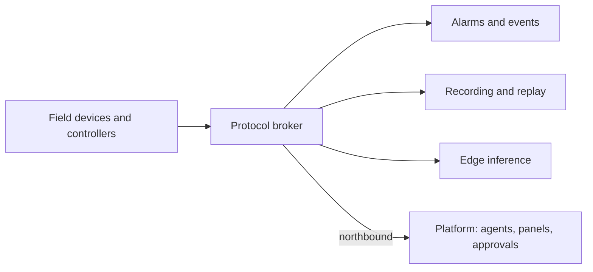

# Evernight — Broker de Protocolos Industriais

A Evernight é a borda industrial: um broker multiplataforma que fala os
protocolos encontrados num site real — Modbus, S7comm, MC Protocol, EtherNet/IP,
EtherCAT, CAN, OPC UA, MQTT —, consulta sensores, avalia alarmes e empurra
eventos para dentro da plataforma. Ela também gerencia runtimes de modelo no
mesmo nó, para inferência que permanece local.

## O que ela faz

- **Protocolos de campo** — adaptadores transformam a leitura e a escrita de
  cada protocolo em leituras e comandos tipados. As escritas são controladas por
  portão: uma escrita industrial precisa de validação de política e de aprovação
  humana a montante antes de qualquer movimento.
- **Sensoriamento e alarmes** — cada estação consulta no seu próprio ciclo
  configurável; as falhas aparecem como eventos de saúde em vez de silêncio. As
  regras de alarme avaliam as leituras e emitem eventos roteados.
- **Tempo e gravação** — as leituras carregam tanto um timestamp de relógio de
  parede quanto um monotônico, para que exibição e ordenação nunca discordem. O
  pipeline de gravação mantém um buffer circular e escreve segmentos em disco,
  e pode reproduzi-los de volta no caminho de gatilho — o pré-requisito tanto
  para o estado do mundo quanto para o aprendizado.
- **Serviço de modelos na borda** — runtimes de modelo são implantados e
  supervisionados no próprio nó, com preferência por GPU e fallback para CPU.
  É isso que torna a inferência reativa independente de um modelo online.
- **Norte** — os eventos sobem para a plataforma por um socket local; gateways
  de dispositivo e de nuvem registram a identidade do nó e a telemetria. Toda
  E/S física passa pela evernight.

## Como você a usa

Na máquina que toca o equipamento. Tudo acima dela — agentes, painéis,
aprovações — fala com ela pela plataforma, nunca diretamente com o barramento
de campo.

A configuração de protocolos, a distribuição de appliance e a referência de
drivers pertencem ao produto; este hub não as duplica.

## Aprofundar-se

- [Princípios de Segurança](../philosophy/safety.md) — por que as escritas passam por portão.
- [Entelecheia](./entelecheia.md) — a camada acima, onde ficam as aprovações.
- [O Ciclo Fechado](../philosophy/closed-loop.md) — onde este segmento se encaixa.
