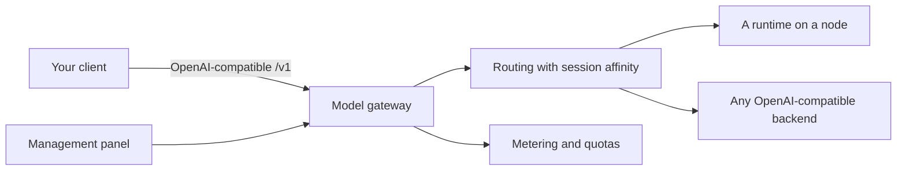

# Arona — шлюз моделей и панель развёртывания

Arona — это место, где модели становятся чем-то, что платформа может
использовать: шлюз, совместимый с OpenAI, перед вашим собственным оборудованием,
плюс консоль, которая им управляет. Она отвечает на один вопрос — как модель
проходит путь от «скачана где-то» до «доступна всем на платформе, учтена и
маршрутизируема».

## Что он делает

- **Шлюз** — обслуживает эндпоинты `/v1/*`, совместимые с OpenAI, поэтому любой
  совместимый с OpenAI клиент может общаться с моделями, которые вы
  размещаете сами.
- **Развёртывание** — скачивает веса моделей на GPU-узлы, запускает там
  рантайм и регистрирует результат как маршрутизируемый бэкенд. Остановка
  развёртывания снимает эту регистрацию.
- **Маршрутизация** — бэкенды регистрируются как локальный рантайм или как
  любой сервис, совместимый с OpenAI, проходят проверку здоровья, и трафик
  направляется к ним с привязкой к сессии. Бэкенд, не прошедший первую
  проверку здоровья, отклоняется, а не пробуется.
- **Идентичность и учёт** — API key аутентифицируют `/v1/*`; каждый вызов
  записывается по ключу с токенами, моделью, бэкендом и стоимостью, а тарифные
  уровни обеспечивают соблюдение квот.

## Как им пользоваться

Большинство людей знакомятся с Arona через панель: создать API key, направить
модель на узел, наблюдать за здоровьем и использованием. Сам чат живёт в другом
месте — рабочее место общается с Arona через её RPC-поверхность, а Arona не
поставляет собственного чат-интерфейса.

Точная поверхность API, рецепты развёртывания и справочник по конфигурации
принадлежат продукту; этот хаб их не дублирует.

> Ранняя разработка. Пока не готова к публичному использованию.

## Подробнее

- [Shittim Chest](./chest.md) — поверхность, которая потребляет Arona.
- [Entelecheia](./entelecheia.md) — агентная платформа за чатом.
- [Краткое руководство](../getting-started/quickstart.md) — разверните свою первую модель.
