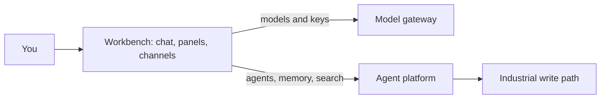

# Shittim Chest — чат, панели и интеграции

Shittim Chest — это поверхность: чат, панели и мультиканальные интеграции —
место, где возможности модели становятся тем, чем вы пользуетесь каждый день.
Он берёт модели и память у Arona, а агентов, панели и промышленные рабочие
процессы — у entelecheia.

## Что он делает

- **Чат** — диалоги сохраняются на стороне сервера с потоковыми ответами,
  поэтому история, шаги размышлений и вызовы инструментов переживают
  перезагрузку страницы и перезапуск.
- **Панели** — панель создаётся из одного промпта: движок генерирует макет и
  компоненты и сохраняет их в рабочем пространстве. Редактирование остаётся
  структурным — привязки источников данных, списки компонентов и состояние
  соединения видны, — а не «чёрным ящиком». Есть три вида: таблицы данных,
  медиа-конвейеры и 3D-двойники парка устройств.
- **Каналы** — один и тот же диалог может прийти из платформы обмена
  сообщениями и быть отвеченным там, через мост каналов.
- **Поиск и знания** — семантический поиск охватывает рабочее пространство и
  долгосрочную память одним ранжированным списком, а базы знаний доступны для
  поиска с той же поверхности.
- **Аутентификация** — делегирована: шлюз устанавливает, кто вызывает, а роли
  ограничивают запись на панелях и в рабочих пространствах.

## Как им пользоваться

Как desktop-приложение или в браузере, с API key из Arona. Веб-интерфейс —
самый быстрый вход; desktop-приложение добавляет нативную оболочку.

Справочник по панелям, конфигурация каналов и переменные окружения
принадлежат продукту; этот хаб их не дублирует.

## Подробнее

- [Arona](./arona.md) — откуда приходят модели, ключи и учёт использования.
- [Entelecheia](./entelecheia.md) — откуда приходят агенты, панели и память.
- [Руководство по веб-интерфейсу](../webui/guide.md) — та же история, экран за экраном.
