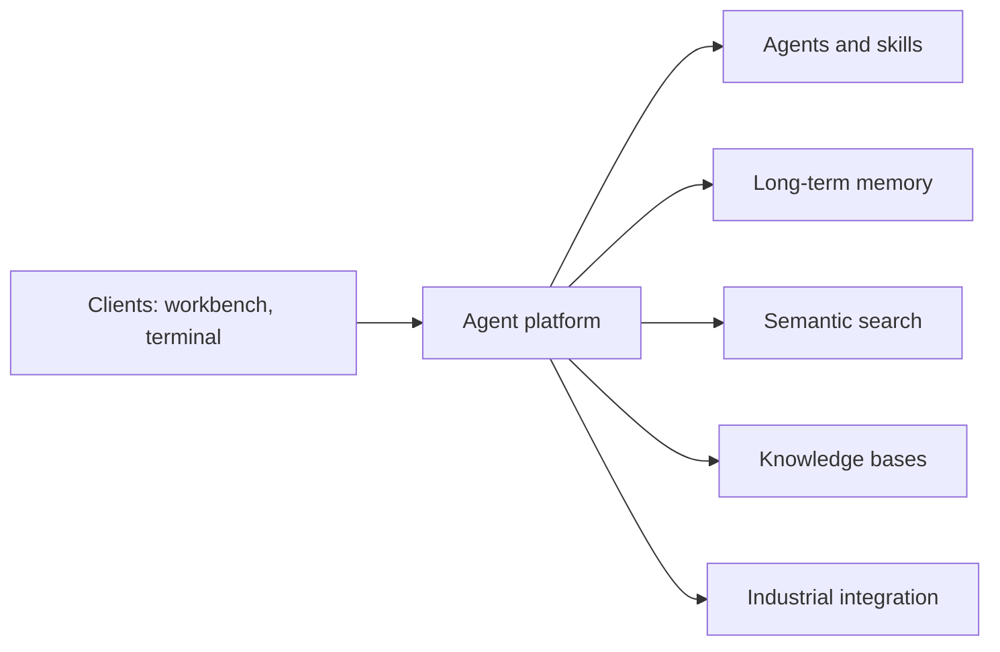

# Entelecheia — агентная платформа и память

Entelecheia — это агентная платформа: она запускает агентов, хранит их
долгосрочную память, отвечает на семантический поиск и несёт слой
промышленной интеграции. Arona и Shittim Chest — оба её потребители:
способность вести беседу с памятью или управлять панелью агентом приходит
отсюда.

## Что она делает

- **Агенты** — специализированные агенты, у каждого своя идентичность,
  инструменты и навыки. Цепочка навыков складывает вызовы моделей и выполнение
  инструментов в конвейер; перед запуском вызова релевантные воспоминания и
  знания извлекаются и внедряются в контекст.
- **Долгосрочная память** — эпизоды, сущности и артефакты хранятся как узлы
  графа памяти и зеркалируются в векторный индекс. Извлечение совмещает
  сходство, обход графа и затухание по времени, а периодический проход
  консолидирует связанные узлы. Память переживает перезапуски.
- **Семантический поиск** — один ранжированный список по двум источникам:
  индексу рабочего пространства (документы, отчёты агентов, базы знаний) и
  долгосрочной памяти.
- **Базы знаний** — создать коллекцию, добавить документы, подписать на неё
  агентов; та же поверхность поиска извлекает из неё.
- **Рефлексия** — усвоенные уроки сохраняются и повторно внедряются в
  последующие промпты: вторая, более лёгкая форма постоянной памяти наряду с
  графом.
- **Промышленная интеграция** — путь записи к реальному оборудованию проходит
  через этот слой, где находятся проверки политик и согласования.

## Как ею пользоваться

Клиенты подключаются через поверхность JSON-RPC платформы с токеном
соединения; терминальный интерфейс и рабочее место для чата — оба такие
клиенты. Запускать entelecheia самостоятельно необязательно — большинство
развёртываний размещается за вас.

Каталог агентов, создание навыков и операционный справочник принадлежат
продукту; этот хаб их не дублирует.

## Подробнее

- [Принципы безопасности](../philosophy/safety.md) — почему модель никогда не касается мира.
- [Evernight](./evernight.md) — слой ниже, где оборудование действительно движется.
- [Shittim Chest](./chest.md) — поверхность, через которую большинство людей встречает агентов.
