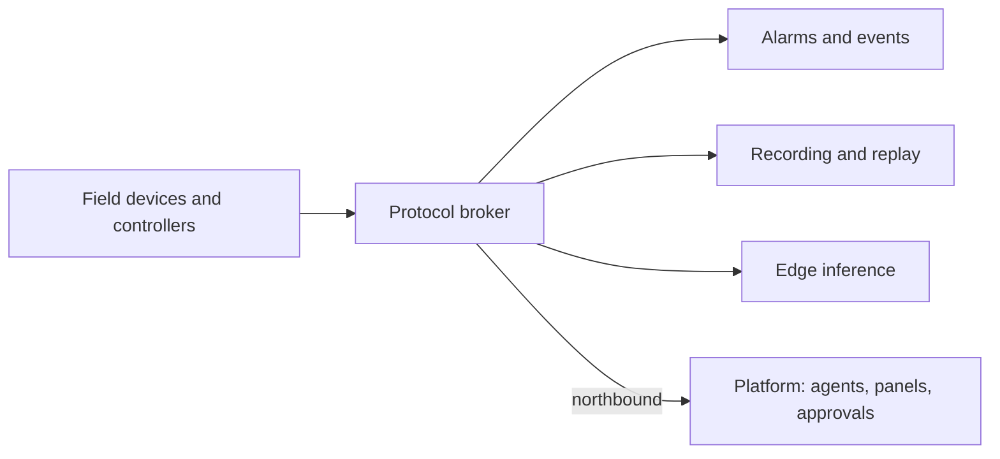

# Evernight — брокер промышленных протоколов

Evernight — это промышленная периферия: кроссплатформенный брокер, который
говорит на протоколах, встречающихся на реальной площадке — Modbus, S7comm,
MC Protocol, EtherNet/IP, EtherCAT, CAN, OPC UA, MQTT, — опрашивает датчики,
вычисляет аварии и передаёт события наверх в платформу. Он также управляет
рантаймами моделей на том же узле для инференса, который остаётся локальным.

## Что он делает

- **Полевые протоколы** — адаптеры превращают чтение и запись каждого
  протокола в типизированные показания и команды. Запись закрыта шлюзом:
  промышленная запись требует проверки политик и подтверждения человеком выше
  по потоку, прежде чем что-либо сдвинется.
- **Сенсорика и аварии** — каждая станция опрашивается по собственному
  настраиваемому циклу; отказы проявляются как события здоровья, а не как
  тишина. Правила аварий вычисляют показания и порождают маршрутизируемые
  события.
- **Время и запись** — показания несут как календарную, так и монотонную
  отметку времени, поэтому отображение и упорядочивание никогда не
  расходятся. Конвейер записи держит кольцевой буфер и пишет сегменты на диск,
  а также может воспроизводить их обратно в путь срабатывания — это
  предпосылка и для состояния мира, и для обучения.
- **Периферийное обслуживание моделей** — рантаймы моделей разворачиваются и
  наблюдаются на самом узле, предпочтительно на GPU с откатом на CPU. Именно
  это делает реактивный инференс независимым от модели, которая онлайн.
- **Северное направление** — события уходят наверх в платформу через локальный
  сокет; шлюзы устройств и облачные шлюзы регистрируют идентичность узла и
  телеметрию. Весь физический ввод-вывод идёт через evernight.

## Как им пользоваться

На машине, которая касается оборудования. Всё, что выше — агенты, панели,
согласования, — общается с ним через платформу и никогда напрямую с полевой
шиной.

Конфигурация протоколов, дистрибутив устройства и контракт драйверов
принадлежат продукту; этот хаб их не дублирует.

## Подробнее

- [Принципы безопасности](../philosophy/safety.md) — почему запись закрыта шлюзом.
- [Entelecheia](./entelecheia.md) — слой выше, где находятся согласования.
- [Замкнутый цикл](../philosophy/closed-loop.md) — где место этого сегмента.
