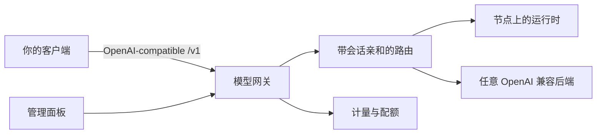

# Arona — 模型网关与部署面板

Arona 是模型变得能为平台所用的地方：架在你自有硬件前面的 OpenAI 兼容网关，加上管理它的控制台。它只回答一个问题——一个模型如何从"被下载到某处"，变成"平台上的每个人都能用、被计量、可路由"。

## 它做什么

- **网关** —— 提供 OpenAI 兼容的 `/v1/*` 端点，因此任何 OpenAI 兼容客户端都能与你自托管的模型对话。
- **部署** —— 把模型权重下载到 GPU 节点，在那里启动运行时，并把结果注册为可路由的后端。停止部署会再次注销它。
- **路由** —— 后端以本地运行时或任意 OpenAI 兼容服务的形式注册，接受健康探测，并以会话亲和路由。尚未通过首次健康探测的后端会被拒绝，而不是被尝试。
- **身份与计量** —— API 密钥为 `/v1/*` 鉴权；每次调用按密钥记录 token、模型、后端与成本，档位强制配额。

## 怎么用

大多数人通过面板认识 Arona：创建 API 密钥、把模型指向某个节点、观察健康与用量。聊天本身在别处——工作台通过 Arona 的 RPC 接口与它对话，Arona 自身不带聊天 UI。

确切的 API 面、部署配方与配置参考属于产品本身；本站不重复它们。

> 早期开发中。尚未准备好供公众使用。

## 深入阅读

- [Shittim Chest](./chest.md) —— 消费 Arona 的界面。
- [Entelecheia](./entelecheia.md) —— 聊天背后的智能体平台。
- [快速开始](../getting-started/quickstart.md) —— 部署你的第一个模型。
