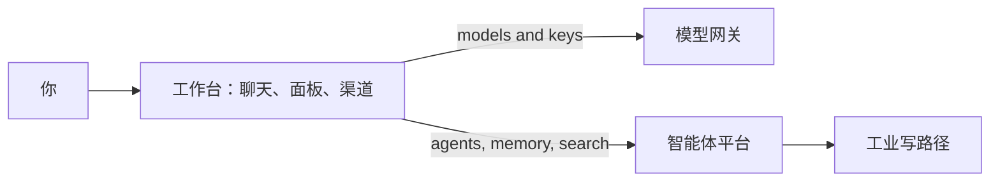

# Shittim Chest — 聊天、面板与集成

Shittim Chest 是界面：聊天、面板与多渠道集成——模型的能力变成你每天都用得到的东西的地方。它从 Arona 取模型与记忆，从 entelecheia 取智能体、面板与工业工作流。

## 它做什么

- **聊天** —— 会话在服务端持久化，响应流式返回，因此历史、思考步骤与工具调用都能熬过一次刷新和一次重启。
- **面板** —— 一块面板由一条提示词创建：引擎生成布局与组件，并把它们持久化进工作区。编辑保持结构化——数据源绑定、组件清单与连接状态都可见——而不是黑盒。共有三种：数据表格、媒体管线，以及设备集群的 3D 孪生。
- **渠道** —— 同一段对话可以从即时通讯平台进来，也在那里被回答，经由渠道桥。
- **搜索与知识** —— 语义搜索把工作区与长期记忆合并成一份排序列表，知识库也可从同一界面检索。
- **认证** —— 委托式：网关确立调用者是谁，角色门控对面板与工作区的写操作。

## 怎么用

作为桌面应用或在浏览器里，使用来自 Arona 的 API 密钥。WebUI 是最快的入口；桌面应用额外提供原生外壳。

面板参考、渠道配置与环境变量属于产品本身；本站不重复它们。

## 深入阅读

- [Arona](./arona.md) —— 模型、密钥与用量的来源。
- [Entelecheia](./entelecheia.md) —— 智能体、面板与记忆的来源。
- [Web UI 指南](../webui/guide.md) —— 同一个故事，逐屏展开。
