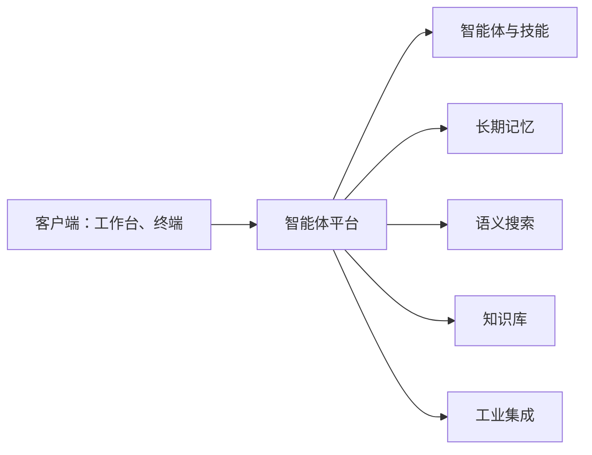

# Entelecheia — 智能体平台与记忆

Entelecheia 是智能体平台：它运行智能体、保管它们的长期记忆、回答语义搜索，并承载工业集成层。Arona 与 Shittim Chest 都是它的消费者——能带着记忆完成一段对话，或用智能体驱动一块面板，能力都来自这里。

## 它做什么

- **智能体** —— 专门化的智能体，各自拥有独立的身份、工具与技能。技能链把模型调用与工具执行组合成管线；在调用运行之前，相关记忆与知识会被检索并注入上下文。
- **长期记忆** —— 情节、实体与制品作为节点存入记忆图，并镜像到向量索引。召回组合相似度、图遍历与时间衰减，并有周期性任务合并相关节点。记忆熬得过重启。
- **语义搜索** —— 一份排序列表覆盖两个来源：工作区索引（文档、智能体报告、知识库）与长期记忆。
- **知识库** —— 创建一个集合、加入文档、订阅智能体；同一搜索界面即可从中检索。
- **反思** —— 经验教训被保存，并重新注入后续提示词，是与记忆图并行的第二种更轻的持久记忆形态。
- **工业集成** —— 通往真实设备的写路径经过这一层，策略校验与审批就在此处。

## 怎么用

客户端凭连接令牌通过平台的 JSON-RPC 接口连接；终端界面与聊天工作台都是这样的客户端。自己运行 entelecheia 是可选的——大多数部署由平台为你托管。

智能体目录、技能编写与运维参考属于产品本身；本站不重复它们。

## 深入阅读

- [安全原则](../philosophy/safety.md) —— 为什么模型永不直接触碰世界。
- [Evernight](./evernight.md) —— 下面那一层，设备真正移动的地方。
- [Shittim Chest](./chest.md) —— 大多数人接触智能体的界面。
