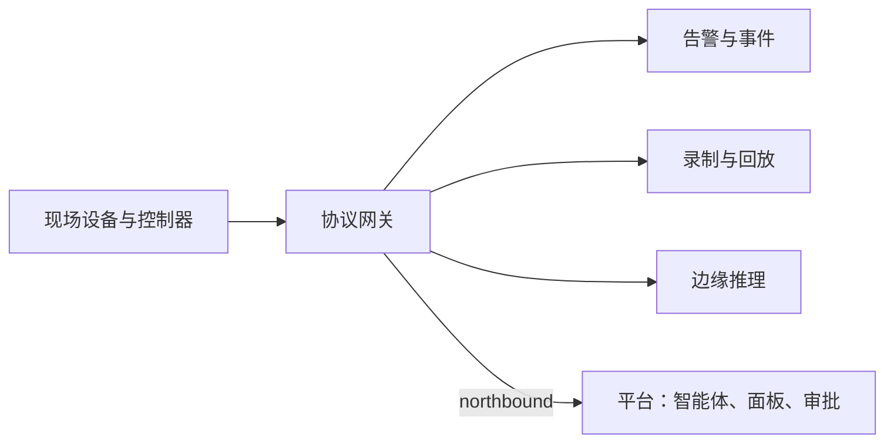

# Evernight — 工业协议网关

Evernight 是工业边缘：一个跨平台的网关，会说真实现场出现的那些协议——Modbus、S7comm、MC Protocol、EtherNet/IP、EtherCAT、CAN、OPC UA、MQTT——轮询传感器、评估告警，并把事件推入平台。它还在同一节点上管理模型运行时，用于留在本地的推理。

## 它做什么

- **现场协议** —— 适配器把各协议的读与写转换为类型化读数与命令。写操作有门控：工业写入需要上游的策略校验与人工审批，然后才有任何动作。
- **感知与告警** —— 每个站按自己可配置的周期轮询；失败以健康事件呈现，而不是沉默。告警规则评估读数并发出带路由的事件。
- **时间与录制** —— 读数同时携带墙钟与单调时间戳，因此显示与排序永不失和。录制管线维护环形缓冲并把分段写入磁盘，还能把它们回放进触发路径——这是世界状态与学习共同的前提。
- **边缘模型服务** —— 模型运行时在节点本身上部署与监督，GPU 优先、CPU 回退。正是它让反应式推理不依赖于在线的模型。
- **北向** —— 事件经由本地 socket 流入平台；设备与云网关注册节点身份与遥测。一切物理 I/O 都经过 evernight。

## 怎么用

运行在接触设备的那台机器上。它之上的一切——智能体、面板、审批——都通过平台与它对话，从不直接面对现场总线。

协议配置、设备发行版与驱动契约属于产品本身；本站不重复它们。

## 深入阅读

- [安全原则](../philosophy/safety.md) —— 为什么写操作有门控。
- [Entelecheia](./entelecheia.md) —— 上面那一层，审批所在之处。
- [闭环](../philosophy/closed-loop.md) —— 这一环嵌在哪里。
