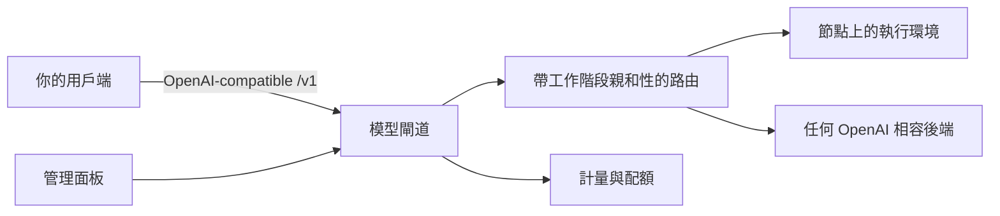

# Arona —— 模型閘道與部署面板

Arona 是模型變成平台可用之物的地方：一套架在自己硬體前面的 OpenAI 相容閘道，加上管理它的控制台。它回答一個問題——模型如何從「下載到某處」變成「平台上每個人都能取用、可計量、可路由」。

## 它做什麼

- **閘道** —— 提供 OpenAI 相容的 `/v1/*` 端點，因此任何 OpenAI 相容用戶端都能與你自己託管的模型對話。
- **部署** —— 把模型權重下載到 GPU 節點、在該處啟動執行環境，並把結果註冊為可路由的後端。停止部署時再行註銷。
- **路由** —— 後端以本機執行環境或任何 OpenAI 相容服務的身分註冊、持續接受健康探測，並以工作階段親和性路由。尚未通過首次健康探測的後端會被拒絕，而不是先試再說。
- **身分與計量** —— API 金鑰認證 `/v1/*`；每次呼叫都按金鑰記錄 token 數、模型、後端與成本，並由等級強制執行配額。

## 如何使用

多數人是透過面板認識 Arona：建立 API 金鑰、把模型指向某個節點、觀察健康與用量。聊天本身住在別處——工作台經由 Arona 的 RPC 介面與之交談，Arona 本身不附帶任何聊天 UI。

完整的 API 介面、部署配方與配置參考屬於該產品；本中心站不重複它們。

> 早期開發中。尚未準備好供公開使用。

## 深入閱讀

- [Shittim Chest](./chest.md) —— 消費 Arona 的那一面。
- [Entelecheia](./entelecheia.md) —— 聊天背後的智能體平台。
- [快速開始](../getting-started/quickstart.md) —— 部署你的第一個模型。
