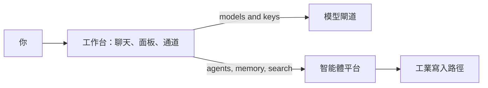

# Shittim Chest —— 聊天、面板與整合

Shittim Chest 是面向使用者的那一面：聊天、面板與多通道整合——把模型的能力變成你每天在用的東西的地方。它從 Arona 取得模型與記憶，從 entelecheia 取得智能體、面板與工業工作流。

## 它做什麼

- **聊天** —— 對話在伺服端持久化並以串流回應，因此歷史、思考步驟與工具呼叫在重新載入與重啟後都還在。
- **面板** —— 一塊面板從單一提示詞建立：引擎生成版面配置與元件，並把它們持久化進工作區。編輯保持結構性——資料來源綁定、元件清單與連線狀態皆可見——而不是黑盒子。共有三種：資料表、媒體管線，與設備機群的 3D 孿生。
- **通道** —— 同一段對話可以從即時通訊平台進來，並在該處被回答，經由通道橋送達。
- **搜尋與知識** —— 語意搜尋橫跨工作區與長期記憶，合成單一排序清單，知識庫也能從同一個介面檢索。
- **認證** —— 委派式：閘道確認呼叫者是誰，角色把守面板與工作區上的寫入。

## 如何使用

以桌面應用程式或瀏覽器使用，搭配來自 Arona 的 API 金鑰。WebUI 是最快的入口；桌面應用程式再加上原生外殼。

面板參考、通道配置與環境變數屬於該產品；本中心站不重複它們。

## 深入閱讀

- [Arona](./arona.md) —— 模型、金鑰與用量從哪裡來。
- [Entelecheia](./entelecheia.md) —— 智能體、面板與記憶從哪裡來。
- [Web UI 指南](../webui/guide.md) —— 同一個故事，逐螢幕展開。
