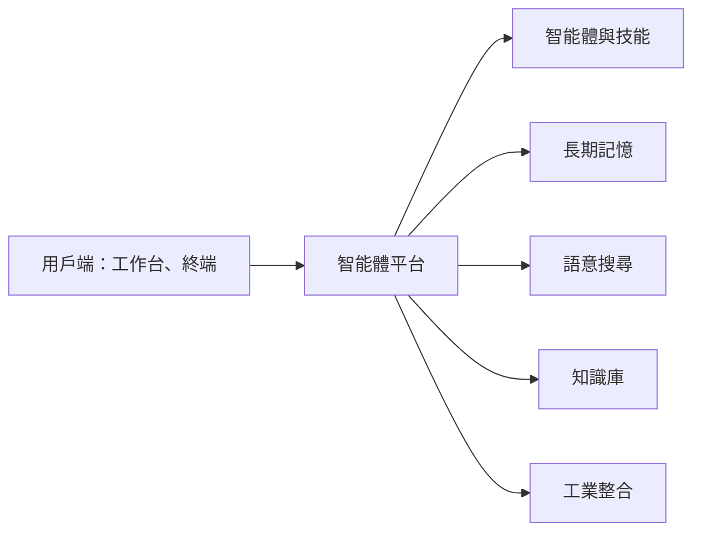

# Entelecheia —— 智能體平台與記憶

Entelecheia 是智能體平台：它執行智能體、維護其長期記憶、回應語意搜尋，並承載工業整合層。Arona 與 Shittim Chest 都是它的消費者——與帶著記憶的對話能力，或用智能體驅動面板的能力，都來自這裡。

## 它做什麼

- **智能體** —— 專精智能體，各有自己的身分、工具與技能。技能鏈把模型呼叫與工具執行組合為管線；每次呼叫執行之前，會先檢索相關記憶與知識並注入上下文。
- **長期記憶** —— 情節、實體與工件作為節點存入記憶圖，並鏡射到向量索引。召回結合相似度、圖遍歷與時間衰減，並有週期性作業合併相關節點。記憶在重啟後留存。
- **語意搜尋** —— 一份排序清單涵蓋兩個來源：工作區索引（文件、智能體報告、知識庫）與長期記憶。
- **知識庫** —— 建立收藏、加入文件、訂閱智能體；同一搜尋介面即可檢索。
- **反思** —— 學到的教訓會被儲存，並重新注入後續提示詞，這是與圖並存的第二種、更輕量的持久記憶。
- **工業整合** —— 通往真實設備的寫入路徑經過這一層，策略校驗與核准就坐落於此。

## 如何使用

用戶端以連線權杖經由平台的 JSON-RPC 介面連接；終端介面與聊天工作台都是這類用戶端。自行執行 entelecheia 是可選的——多數部署由我們為你託管。

智能體清單、技能撰寫與維運參考屬於該產品；本中心站不重複它們。

## 深入閱讀

- [安全原則](../philosophy/safety.md) —— 為什麼模型永不觸碰世界。
- [Evernight](./evernight.md) —— 下面那一層，設備真正移動的地方。
- [Shittim Chest](./chest.md) —— 多數人接觸智能體的那一面。
