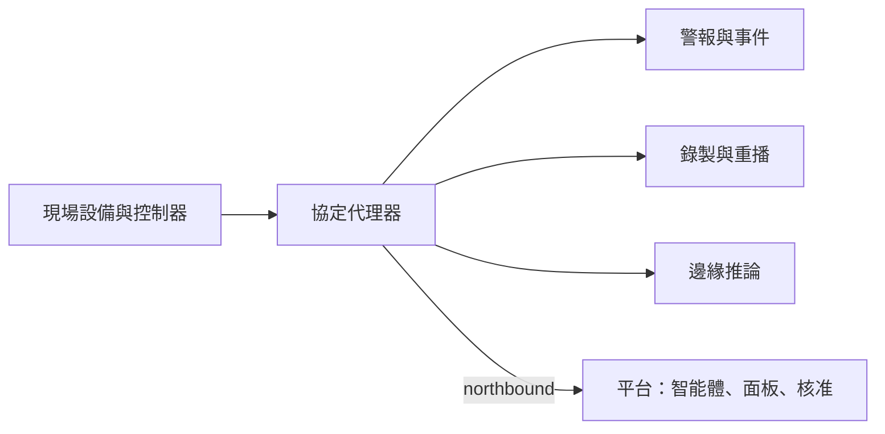

# Evernight —— 工業協定代理器

Evernight 是工業邊緣：一個跨平台代理器，會講真實現場出沒的各種協定——Modbus、S7comm、MC Protocol、EtherNet/IP、EtherCAT、CAN、OPC UA、MQTT——輪詢感測器、評估警報，並把事件向上推入平台。它同時管理同一節點上的模型執行環境，供留在本機的推論使用。

## 它做什麼

- **現場協定** —— 轉接器把每個協定的讀與寫轉換為帶型別的讀值與命令。寫入設有閘門：工業寫入必須先在上游通過策略校驗與人工核准，一切才會動作。
- **感測與警報** —— 每個站點依自身可配置的週期輪詢；故障以健康事件浮現，而不是靜默。警報規則對讀值求解，並發出按主題路由的事件。
- **時間與錄製** —— 讀值同時攜帶壁鐘時間與單調時間戳，因此顯示與排序永不衝突。錄製管線維護環形緩衝並把分段寫入磁碟，還能將分段重播回觸發路徑——這是世界狀態與學習兩者共同的前提。
- **邊緣模型服務** —— 模型執行環境在節點本身上部署與監督，GPU 優先、CPU 回退。這正是讓反應式推論獨立於線上模型的原因。
- **北向** —— 事件經由本機 socket 向上流入平台；設備與雲端閘道註冊節點身分與遙測。所有實體 I/O 都經由 evernight。

## 如何使用

安裝在接觸設備的那台機器上。它之上的一切——智能體、面板、核准——都經由平台與它對話，絕不直接觸碰現場匯流排。

協定配置、硬體機分發與驅動契約屬於該產品；本中心站不重複它們。

## 深入閱讀

- [安全原則](../philosophy/safety.md) —— 為什麼寫入要設閘門。
- [Entelecheia](./entelecheia.md) —— 上面那一層，核准所在之處。
- [閉環](../philosophy/closed-loop.md) —— 這一環在整體中的位置。
